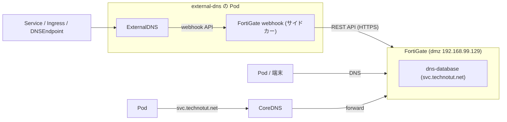

Kubernetes の Service・Ingress のホスト名を、`svc.technotut.net` の DNS レコードとして FortiGate に自動登録します。ExternalDNS が Kubernetes の資源を監視し、専用の webhook が FortiGate の REST API を呼出してレコードを更新します。FortiGate 側の設定手順は [Kubernetes 構築方法](/compute/deploy) の「DNS (ExternalDNS と FortiGate)」を参照してください。

<RepoCard repo="TechnoTUT/external-dns-fortigate-webhook" />

## 全体構成


- ゾーン `svc.technotut.net` の権威サーバは FortiGate です。ExternalDNS は DNS プロトコルではなく、FortiGate の REST API でレコードを更新します。
- 各 VLAN の端末は、DHCP で配布される FortiGate (ゲートウェイ) を DNS サーバに使用します。
- クラスタ内の Pod は、CoreDNS が `svc.technotut.net` を FortiGate (`dns_server`) に転送して名前解決します。

## 登録元
ExternalDNS の `sources` は `service`・`ingress`・`crd` の 3 種類です。

| 登録元 | 指定方法 |
|---|---|
| Service | annotation `external-dns.alpha.kubernetes.io/hostname: <名前>.svc.technotut.net` を付与 |
| Ingress | `host` を `svc.technotut.net` 配下で指定 |
| DNSEndpoint (CRD) | `externaldns.k8s.io/v1alpha1` の `DNSEndpoint` に記述。固定レコードに使用 |

Service の例 (`k8s/manifest/plmux/service.yaml`):
```yaml
metadata:
  name: plmux
  annotations:
    external-dns.alpha.kubernetes.io/hostname: plmux.svc.technotut.net
spec:
  type: LoadBalancer
```

LoadBalancer の IP は Cilium が割当て、その IP が A レコードになります。Argo CD の UI (`cd.svc.technotut.net`) も、`argocd-server` の Service に同じ annotation を付与して登録しています (`argocd_hostname`)。

## 動作方針
| 項目 | 設定 | 理由 |
|---|---|---|
| `provider` | `webhook` | FortiGate 用の公式の実装がないため、専用の webhook を使用 |
| `registry` | `noop` | FortiGate の `dns-entry` は TXT を置けず、所有者の記録 (TXT registry) が使えない |
| `policy` | `sync` | Kubernetes 側に存在しないレコードを削除 |
| `managedRecordTypes` | `A`, `AAAA`, `CNAME` | 対象のレコード種別 |
| `domainFilters` | `svc.technotut.net` | 対象のゾーンを限定 |
| `interval` | `1m` | 同期の間隔 |

`registry: noop` と `policy: sync` の組合せにより、ゾーンは **webhook 専用** となります。FortiGate に手で書いたエントリは、次の同期で削除されます。固定のレコードは、次節の `dns_static_records` に記述してください。

## 固定のレコード
`inventory/group_vars/all/main.yml` の `dns_static_records` に記述します。Ansible が `DNSEndpoint` (`static-records`) として配置し、ExternalDNS が他のレコードと同様に FortiGate へ反映します (雛形は `k8s/ansible/roles/addons/templates/dns-static-records.yaml.j2`)。

| 名前 | アドレス | 用途 |
|---|---|---|
| `pa` | `192.168.12.22` | PA 機器 |
| `registry` | `10.96.0.100` | クラスタ内のレジストリ (ClusterIP。クラスタ外からは到達不可) |
| `drive` | `10.14.0.128` | nas クラスタの Samba (LoadBalancer) |

## 逆引き
webhook が A レコードから PTR を生成し、次の逆引きゾーンに登録します (`externaldns_fortigate_reverse_zones`)。

| ゾーン | 対象 |
|---|---|
| `12.10.in-addr.arpa` | main の LoadBalancer (`10.12.0.0/16`) |
| `0.14.10.in-addr.arpa` | nas の LoadBalancer (`10.14.0.0/24`) |

## 導入
Ansible の `addons` ロールが、`site.yml` から `tasks_from: dns` で導入します (`dns_enabled`)。nas クラスタは `dns_enabled: false` であり、`drive.svc.technotut.net` は main の ExternalDNS が登録します。

1. Namespace `external-dns` と、FortiGate の API キーの Secret (`external-dns-fortigate`) を作成。
2. CoreDNS の Corefile に、`svc.technotut.net` を FortiGate へ転送する設定を追加。
3. Helm チャート `external-dns` (`externaldns_chart_version`) を導入。webhook はサイドカーとして同居します。
4. 固定のレコード (`DNSEndpoint`) を配置。

| 変数 | 既定値 | 意味 |
|---|---|---|
| `dns_namespace` | `external-dns` | 導入先の namespace |
| `dns_zone` | `svc.technotut.net` | 管理対象のゾーン |
| `dns_server` | `192.168.99.129` | FortiGate (dmz)。CoreDNS の転送先と REST API の宛先 |
| `externaldns_chart_version` | `1.21.1` | Helm チャートの版数 |
| `externaldns_webhook_image` / `externaldns_webhook_tag` | `ghcr.io/technotut/external-dns-fortigate-webhook` / `0.1.1` | webhook のイメージ |
| `externaldns_fortigate_insecure` | `true` | FortiGate の証明書が自己署名のため、検証を省略 |
| `externaldns_fortigate_token_in_query` | `false` | Bearer ヘッダで認証できない場合に `true` |
| `externaldns_fortigate_dry_run` | `false` | `true` なら FortiGate へ書込まず、内容をログに出力 |
| `externaldns_helm_wait` | `true` | webhook が FortiGate に到達するまで待機 |

- **API キー:** Ansible Vault の `vault_externaldns_fortigate_token` に保管し、Secret から webhook に渡します。Git に平文では置きません。
- **イメージの取得元:** DNS がクラスタ内のレジストリに依存しないよう、GHCR から直接取得します。
- **webhook の保護:** 非 root (UID 65532)、読取専用のルートファイルシステム、全 capability の破棄で実行します。

## 動作確認
```bash
# ExternalDNS と webhook の状態
kubectl -n external-dns get pods
kubectl -n external-dns logs deploy/external-dns-fortigate -c webhook

# レコードの確認 (Pod から)
kubectl run -it --rm dnstest --image=busybox --restart=Never -- nslookup plmux.svc.technotut.net
```

FortiGate 側の確認は次のとおりです。
```
show system dns-database
diagnose sys sdn status
```

## 運用上の注意
- 以前は、クラスタ内の bind9 (`10.12.0.0`) が `svc.technotut.net` を提供していました。2026-11-18 に本構成へ移行し、bind9 は削除済みです。DNS サーバに `10.12.0.0` を直接指定しているクライアントは、FortiGate に変更してください。
- FortiGate のゾーンは `authoritative enable` (既定値) で使用します。この設定では、ゾーンに存在しない名前に NXDOMAIN を返し、`forwarder` は使用されません。
- webhook は FortiGate の REST API に依存します。FortiGate に到達できない間は、レコードの更新が滞ります (既存のレコードは FortiGate に残り、名前解決は継続します)。
