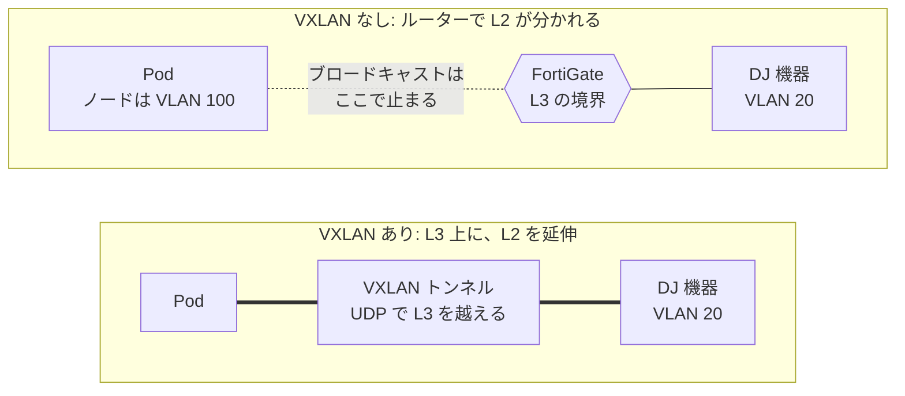
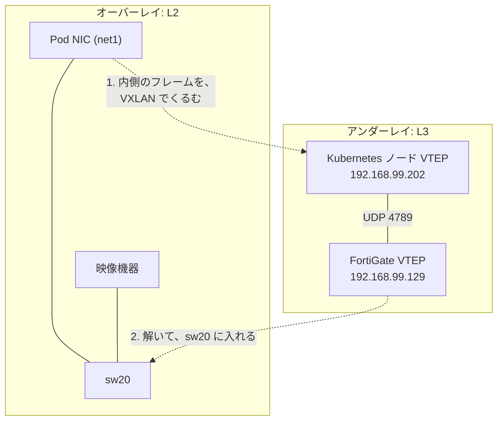
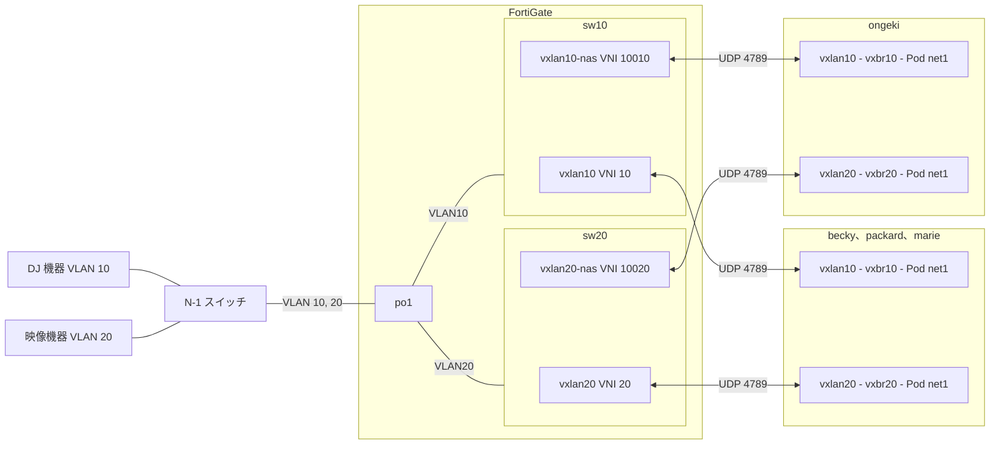

Kubernetes の Pod を、各 VLAN へ L2 で直接接続するため、FortiGate と Kubernetes ノード間通信に VXLAN を採用しています。Kubernetes ノード側は CNI プラグイン [vxlan-cni](https://github.com/TechnoTUT/vxlan-cni) が、FortiGate 側は software switch が担当します。Pod の使用方法と VLAN の追加手順は [Kubernetes 構築方法](/compute/deploy) を参照してください。

## VXLAN プロトコルの理解
このページを読むための、VXLAN (Virtual eXtensible LAN、[RFC 7348](https://datatracker.ietf.org/doc/html/rfc7348)) の基礎です。

### VXLAN とは
Ethernet のフレームを、そのまま UDP パケットの中に入れて、IP ネットワークの上で運びます。離れた場所にある機器どうしを、同じ L2 につなげられます。ケーブルや L2 スイッチでつなぐことのできない場所でも、IP で通信できれば、同じ VLAN を遠くまで延伸できます。

| 用語 | 意味 | この環境での例 |
| :--- | :--- | :--- |
| VNI (VXLAN Network Identifier) | VXLAN セグメント番号。24 ビット。VLAN ID は 12 ビット | VLAN 20 の VNI は `20` |
| VTEP (VXLAN Tunnel End Point) | フレームをくるむ場所と、解く場所 | 各ノードの `vxlan20`、FortiGate の `vxlan20` |
| アンダーレイ | VXLAN のパケットを運ぶ、外側の IP ネットワーク | サーバ用の VLAN 100、FortiGate の `dmz`、`192.168.99.128/25` |
| オーバーレイ | VXLAN の中を流れる、内側の L2 | VLAN 20 の Pod と機器、FortiGate の `sw20` |

### なぜ L3 の上に L2 を作るのか
DJ 機器の PRO DJ LINK や、Ableton Link、ARP は、**同じ L2、つまり同じブロードキャストドメインの中**でしか届きません。しかし、Kubernetes のノードは、サーバ用の VLAN 100 に所属しており、DJ 機器や映像機器がいる VLAN 10・20 とは、L3 (Layer 3) ルーターである FortiGate を挟んで別のネットワークです。



VXLAN は、ルーターを越えて IP で届く経路の上に、「見かけ上の L2」であるオーバーレイネットワークを作ります。Pod は、物理の VLAN 20 に接続した機器と同じ L2 にいるように通信できます。



## 全体構成


各 VLAN の機器と Pod は、同じ software switch の `sw10`、`sw20`、`sw30`、`sw40`、`sw42` から `sw45` の中で、同一のブロードキャストドメインに所属します。ゲートウェイ、DHCP サーバ、DNS サーバ、ポリシーは software switch が保持します。VLAN は VXLAN の VNI として伝送します。

## VNI の割当
VNI は `VLAN ID + vniOffset` で決定します。例えば VLAN 44 は、main が 44、nas が 10044 になります。

| クラスタ | FortiGate 側のインターフェース | VTEP の IP アドレス `remote` | `vniOffset` | VLAN 10 の VNI | VLAN 20 の VNI |
|---|---|---|---|---|---|
| main | `dmz` `vxlan10` `vxlan20` | `192.168.99.129` | 0 | 10 | 20 |
| nas | `port9` `vxlan10-nas` `vxlan20-nas` | `192.168.98.1` | 10000 | 10010 | 10020 |

nas に別系統の VNI を使用する理由は、FortiGate の仕様上の制約です。  

- VNI 一つにつき、VXLAN インターフェースを一つしか作成できない。
- VXLAN インターフェースは、紐付けた物理インターフェースからのみ、カプセル化したパケットを送出する。  

main と nas の Pod 間の通信は、同一の software switch に所属する構成員、例えば `vxlan10` と `vxlan10-nas` として、FortiGate が中継します。

## ノード側の vxlan-cni
<RepoCard repo="TechnoTUT/vxlan-cni" />

### 導入
Ansible の次のロールが導入を担当します。変数は `k8s/ansible/inventory/group_vars/all/main.yml` に定義し、nas は `nas_cluster.yml` で上書きします。

| ロール | 内容 |
|---|---|
| `vxlan_cni` | `/opt/cni/bin/vxlan` を GitHub のリリースから取得し、SHA256 で検証。`dhcp` プラグインの常駐プロセス `cni-dhcp.service` を全ノードに配置 |
| `addons` | NAD `kube-public/vxlan` を作成 |

`dhcp` プラグインは `kubernetes-cni` のパッケージが `/opt/cni/bin/dhcp` に配置します。不在の場合、ロールは即時中断します。

| 変数 | 既定値 | 意味 |
|---|---|---|
| `vxlan_cni_enabled` | `true` | ロールと NAD の有効化 |
| `vxlan_cni_version` | `v0.2.0` | プラグインの版数。`vxlan_cni_sha256` と同時に更新する |
| `vxlan_cni_remote` | `192.168.99.129` | FortiGate 側の VTEP。nas は `192.168.98.1` |
| `vxlan_cni_vni_offset` | `0` | VNI = VLAN ID + 本値。nas は `10000` |
| `vxlan_cni_allowed_vlans` | `[10, 20, 30, 40, 42, 43, 44, 45]` | Pod が選択可能な VLAN。FortiGate に VXLAN と software switch を作成済みの VLAN だけを入れる。空の場合は NAD を非配置 |
| `vxlan_cni_nad_name` / `vxlan_cni_nad_namespace` | `vxlan` / `kube-public` | NAD の名称と namespace |

### NAD (Network Attachment Definition)
NAD は全 VLAN 共通の一つのみです。雛形は `k8s/ansible/roles/addons/templates/nad-vxlan.yaml.j2` にあります。

```json
{
  "cniVersion": "1.0.0",
  "name": "vxlan",
  "type": "vxlan",
  "remote": "192.168.99.129",
  "vniOffset": 0,
  "peers": ["<main の全ノードの node_ip>"],
  "allowedVlans": [10, 20, 30, 40, 42, 43, 44, 45],
  "ipam": { "type": "dhcp" }
}
```

| キー | 内容 |
|---|---|
| `remote` | FortiGate 側の VTEP の IP アドレス |
| `vniOffset` | VNI の加算値 |
| `peers` | 同一 VXLAN 上の対向ノードの IP。`k8s` グループの `node_ip` を使います。詳細は「ノード間通信」を参照 |
| `allowedVlans` | `cni-args` の `vlan` に指定可能な値。範囲外はプラグインが拒否 |
| `ipam` | `dhcp`。FortiGate の DHCP サーバから IP アドレスを取得 |

NAD だけを作り直すには、`vxlan_cni_allowed_vlans` や `peers` を変えたあと、`site.yml` 全体を流さずに、次を main と nas のそれぞれの inventory で実行します。
```bash
cd k8s/ansible
ansible control_plane -i inventory/hosts.yml -m ansible.builtin.include_role -a "name=addons tasks_from=vxlan-nad"
ansible control_plane -i inventory/nas.yml   -m ansible.builtin.include_role -a "name=addons tasks_from=vxlan-nad"
```

### Pod での指定
```yaml
metadata:
  annotations:
    k8s.v1.cni.cncf.io/networks: |
      [{ "name": "vxlan", "namespace": "kube-public", "cni-args": { "vlan": 20 } }]
```

Pod には、Cilium の `eth0` に加えて `net1` が付与されます。

### Pod 作成時のノードの動作
1. Multus が `vxlan` プラグインを呼出。
2. プラグインがノード上に `vxlan<VLAN>` とブリッジ `vxbr<VLAN>` を作成。既存の場合は再利用。
3. Pod の `net1` を veth で `vxbr<VLAN>` に接続。MTU は 1450。
4. `dhcp` IPAM が `cni-dhcp.service` を介して、Pod の netns 内で DHCP を実行。
5. 当該 VLAN の Pod がノードから消滅すると、`vxlan<VLAN>` と `vxbr<VLAN>` を撤去。

DHCP 応答に含まれる既定経路は破棄します。Pod の既定経路は、従来どおり Cilium の `eth0` です。

### MTU
MTU は 1450 です。VXLAN の付加情報 50 バイトを差し引いた値です。

### ノード間通信
FortiGate は、同一の VXLAN インターフェースに属する対向同士の通信を中継しません。したがって、main の別ノード間の Pod 通信は、`peers` に登録したノードの IP 宛に、ノード同士が直接 VXLAN で送受信します。ノードの増設時は `peers` が変動するため、`site.yml` を実行して NAD を更新し、FortiGate の `remote-ip` も更新します。

## FortiGate の設定例

```
config system vxlan
    edit "vxlan10"
        set interface "dmz"
        set vni 10
        set remote-ip "192.168.99.200" "192.168.99.201" "192.168.99.202"
    next
    edit "vxlan10-nas"
        set interface "port9"
        set vni 10010
        set remote-ip "192.168.98.2"
    next
    edit "vxlan20"
        set interface "dmz"
        set vni 20
        set remote-ip "192.168.99.200" "192.168.99.201" "192.168.99.202"
    next
    edit "vxlan20-nas"
        set interface "port9"
        set vni 10020
        set remote-ip "192.168.98.2"
    next
end
config system switch-interface
    edit "sw10"
        set vdom "root"
        set member "VLAN10" "vxlan10" "vxlan10-nas"
    next
    edit "sw20"
        set vdom "root"
        set member "VLAN20" "vxlan20" "vxlan20-nas"
    next
end
```

| software switch | IP アドレス | 構成員 |
|---|---|---|
| `sw10` DJ | `10.10.0.1/20` | `VLAN10`、`vxlan10`、`vxlan10-nas` |
| `sw20` AV | `10.10.16.1/20` | `VLAN20`、`vxlan20`、`vxlan20-nas` |
| `sw30` LBAR | `192.168.11.1/24` | `VLAN30`、`vxlan30`、`vxlan30-nas` |
| `sw40` PA | `192.168.12.1/27` | `VLAN40`、`vxlan40`、`vxlan40-nas` |
| `sw42` ENTRANCE | `192.168.12.33/28` | `VLAN42`、`vxlan42`、`vxlan42-nas` |
| `sw43` LDISP | `192.168.12.49/28` | `VLAN43`、`vxlan43`、`vxlan43-nas` |
| `sw44` CAM1 | `192.168.12.65/28` | `VLAN44`、`vxlan44`、`vxlan44-nas` |
| `sw45` CAM2 | `192.168.12.81/28` | `VLAN45`、`vxlan45`、`vxlan45-nas` |

- `remote-ip` の `192.168.99.200` から `202` は main のノード becky、packard、marie で、`192.168.98.2` は nas のノード ongeki です。

## 運用上の制約
- software switch の構成員として使用中の VXLAN インターフェースは、`remote-ip` を変更できません。ノード増設時は、一旦 software switch から切離し、変更後に再度組込みます。この間、VXLAN 上の Pod 通信は一時停止します。
- VXLAN のカプセル化と software switch の転送は、FortiGate 100D では CPU が処理します。大容量の通信を扱う VLAN に適用する際は、CPU 使用率の監視が必須です。
- Pod が選択可能な VLAN は、FortiGate に VXLAN と software switch を作成済みの VLAN に限定されます。VLAN の追加手順は [Kubernetes 構築方法](/compute/deploy) の「VLAN を追加する手順」を参照してください。

## 動作確認
```bash
# ノードの VTEP とブリッジ
ip -d link show type vxlan        # vxlan id (VNI)、remote、local、dstport 4789 を見る
ip link show type bridge
bridge fdb show dev vxlan20       # iproute2 の bridge コマンドが入っているノードだけ

# Pod の net1 の IP アドレスと MTU
kubectl exec <pod> -- ip addr show net1

# DHCP 常駐プロセス
systemctl status cni-dhcp
```

FortiGate 側の確認は次のとおりです。
```
diagnose netlink brctl name host sw20    # software switch の MAC 表
get system arp
```
