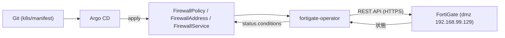

FortiGate のファイアウォールポリシー、アドレス、サービスを、Kubernetes の manifest で管理します。コントローラ [fortigate-operator](https://github.com/TechnoTUT/fortigate-operator) が manifest の内容を FortiGate の REST API で反映するため、ポリシーを必要とするアプリケーションの manifest と同じ Git の管理下に置けます。本書は、その全体構成を整理したものです。

<RepoCard repo="TechnoTUT/fortigate-operator" />

## 全体構成


- コントローラ本体 (CRD、RBAC、Deployment) は、Argo CD の Application `fortigate-operator` が導入します。
- API キーの Secret のみ Ansible が作成します。
- ポリシーは、アプリケーションの manifest (例: `k8s/manifest/plmux/firewallpolicy.yaml`) に同居させます。
- 反映は main クラスタのコントローラのみが担当します。nas クラスタでは `fortigate_operator_enabled: false` です。

## 資源
全て namespace 単位で、API グループは `fortigate.technotut.net/v1alpha1` です。項目名と値は FortiOS の CLI (`set srcintf ...`、`set nat enable`) に準拠します。

| 種類 | FortiGate の表 | 短縮名 |
|---|---|---|
| `FirewallPolicy` | `config firewall policy` | `fgpol` |
| `FirewallAddress` | `config firewall address` (ipmask, iprange, fqdn、Service の LB IP) | `fgaddr` |
| `FirewallService` | `config firewall service custom` (TCP, UDP, SCTP) | `fgsvc` |

実例 (`k8s/manifest/plmux/firewallpolicy.yaml`): plmux の Pod から VLAN 20 の dmxctl への OSC (UDP 9000) を許可します。Pod の通信はノードの IP (dmz) に SNAT されて FortiGate を通ります。

```yaml
apiVersion: fortigate.technotut.net/v1alpha1
kind: FirewallService
metadata:
  name: plmux-osc
spec:
  name: OSC-9000
  udpPortrange: ["9000"]
  comment: dmxctl OSC
---
apiVersion: fortigate.technotut.net/v1alpha1
kind: FirewallPolicy
metadata:
  name: al-plmux-osc
spec:
  srcintf: [dmz]
  dstintf: [sw20]
  srcaddr: [dmz]
  dstaddr: [VLAN20 subnet]
  service: [OSC-9000]
  action: accept
  comments: plmux OSC to dmxctl (VLAN20)
```

### Service の LB IP を宛先にする
クラスタ内のアプリケーションへの通信を許可するときは、宛先を SDN コネクタの動的アドレス `k8s-svc` にしません。`k8s-svc` にはクラスタの全 Service の IP が入るため、あるアプリケーションのために開けたポートが、他のアプリケーションにも開いてしまいます。\
代わりに `FirewallAddress` の `spec.serviceRef` で、同じ namespace の `LoadBalancer` の Service を指定します。コントローラが Service の IPv4 の LB IP を `/32` のアドレスとして作成し、LB IP が変わると FortiGate のアドレスも書換えます。ポリシーはアドレスを名前で参照するため、ポリシーは書換わりません。

実例 (`k8s/manifest/cam1/firewallpolicy.yaml`):

```yaml
apiVersion: fortigate.technotut.net/v1alpha1
kind: FirewallAddress
metadata:
  name: k8s-cam1-nginx
  namespace: cam1
spec:
  serviceRef:
    name: cam1-nginx-service
  associatedInterface: dmz
  comment: LB IP of Service cam1-nginx-service
---
apiVersion: fortigate.technotut.net/v1alpha1
kind: FirewallPolicy
metadata:
  name: al-cam1-cam
  namespace: cam1
spec:
  srcintf: [VLAN44]
  dstintf: [dmz]
  srcaddr: [VLAN44 address]
  dstaddr: [k8s-cam1-nginx]
  service: [HTTP, RTMP]
  action: accept
  comments: cam1 from camera VLAN44
```

- アドレスの名前は `k8s-<アプリケーション>` とします。
- Service に LB IP がまだない場合や、Service が `LoadBalancer` でない場合、資源は `ReferenceNotFound` となり、FortiGate には何も作成しません。
- Service を削除しても、FortiGate のアドレスは最後の IP のまま残ります。その IP が他の Service に割当てられると開放されたままになるため、`FirewallAddress` は Service と一緒に削除してください。
- 書込んだアドレスは `kubectl get fgaddr -A` の `Address` 列で確認できます。
- Cilium Ingress の共有 LB で受けるもの (例: dmxctl の操作パネル) は、引続き `k8s-ingress` を宛先にします。

ポリシーは、インターフェース、アドレス、サービスを FortiGate 上の名前で参照します。VXLAN で接続した VLAN (10、20、30、40、42〜45) は、software switch (`sw10`、`sw20`、`sw30` など) がインターフェースとなり、`VLAN10 subnet` のような ipmask のアドレスで指定します。VLAN インターフェース (`VLAN44` など) とその `VLAN44 address` は、ポリシーでは使えません ([VXLAN の実装](/computing/vxlan) を参照)。

状態は次のコマンドで確認します。
```bash
kubectl get fortigate -A
```

### 共通の項目
| 項目 | 内容 |
|---|---|
| `spec.name` | FortiGate 上の名称。既定は `metadata.name`。後から変更不可。上限はポリシー 35 文字、アドレスとサービス 79 文字 |
| `spec.deletionPolicy` | `Delete` (既定) は資源の削除時に FortiGate の対象も削除。`Orphan` は残置 |
| `status.conditions[type=Ready]` | 一致していれば `True` (理由 `Synced`)。他の理由は `Conflict`、`FortiGateError`、`InvalidSpec`、`ReferenceNotFound`、`NotConverged`、`DeleteFailed`、`DryRun` |

## 調整の方式
- 資源と FortiGate の対象を項目ごとに比較し、差異のある項目のみ書込みます。一致していれば書込まないため、FortiGate が設定の保存 (版数の増加) を繰返しません。
- 全資源を `RESYNC_INTERVAL` (既定 5 分) ごとに再確認します。FortiGate 上で手動により変更された管理対象は、元に戻されます。
- 参照のリスト (`srcaddr`、`service` など) は集合として比較し、順序は問いません。
- 書込み後に読戻し、FortiGate が異なる値を保存した場合は `NotConverged` として報告します (無限に書直すことはしません)。
- finalizer が、資源の削除前に FortiGate の対象を削除します。削除が拒否された場合 (管理外のポリシーが使用中のアドレスなど) は、`DeleteFailed` で再試行します。
- ポリシーは 1 件ずつ調整します。

### 所有の管理
コントローラは、作成した対象のコメント欄 (ポリシーは `comments`、アドレスとサービスは `comment`) の先頭に `[k8s:<namespace>/<name>]` の印を付けます。印は FortiGate 側に残るため、クラスタを再構築しても、同じ manifest が対象を再び引継ぎます。

- 同名で印のない既存の対象は、変更も削除もしません。資源は `Conflict` を報告します。
- 既存の対象を管理下に置くには、annotation `fortigate.technotut.net/adopt: "true"` を付与します。コントローラが内容を manifest で上書きし、印を付けます。
- 別の資源の印がある対象は、annotation があっても引継ぎません。

### ポリシーの順序
FortiGate は上から順にポリシーを評価します。新規のポリシーは末尾 (暗黙の拒否の直上) に追加されます。他のポリシーの上下に置くには、`spec.position.before` か `spec.position.after` に、対象の FortiGate 上の名称を指定します。相手のポリシーが存在しない場合は `ReferenceNotFound` となります。

### 権限
`FirewallPolicy` を作成できる者は、ファイアウォールを開放できます。`fortigate.technotut.net` の資源の作成・更新・削除は、クラスタ管理者と Argo CD に限定してください。Kubernetes 既定の `admin`・`edit` の ClusterRole には、集約ラベルがないため含まれません。

## 導入
| 項目 | 内容 |
|---|---|
| Application | `k8s/manifest/apps/fortigate-operator.yaml`。`syncPolicy` は `automated` (`prune: false`、`selfHeal: true`)、`ServerSideApply=true` |
| 本体 | `k8s/manifest/fortigate-operator` の kustomization が、リポジトリ `TechnoTUT/fortigate-operator` の `config/default` をリリース (`ref=v0.1.0`) で取込む。イメージのタグも同じリリース (`0.1.0`) に固定し、環境変数のみ上書き |
| API キー | Ansible の `fortigate-operator.yml` が Secret `fortigate-operator` を作成。Ansible Vault の `vault_fortigate_operator_token` に保管 |
| namespace | `fortigate-operator` (`fortigate_operator_namespace`) |

| 環境変数 | 値 | 意味 |
|---|---|---|
| `FORTIGATE_URL` | `https://192.168.99.129` | FortiGate の `dmz` |
| `FORTIGATE_INSECURE_SKIP_VERIFY` | `true` | FortiGate の証明書が自己署名のため、検証を省略 |
| `DRY_RUN` | `false` | `true` なら FortiGate へ書込まず、内容をログと資源の status に出力 |
| `FORTIGATE_TOKEN` | Secret から取得 | REST API の API キー |

2026-11-18 に書込みを有効化しました (`DRY_RUN: false`)。有効化の前に、無効なテスト用ポリシーで、作成、順序の変更、更新、ずれの修復、削除を FortiOS 6.2 で確認しています。ただし、拒否のポリシーでの `logtraffic` は未検証です。

## FortiGate の設定
実際の設定に合わせて調整してください。

```
config system accprofile
    edit "fortigate-operator"
        set fwgrp custom
        config fwgrp-permission
            set policy read-write
            set address read-write
            set service read-write
            set schedule read
        end
    next
end
config system api-user
    edit "fortigate-operator"
        set accprofile "fortigate-operator"
        set vdom "root"
        config trusthost
            edit 1
                set ipv4-trusthost 192.168.99.128 255.255.255.128    # Pod の通信はノードの IP に NAT される
            next
        end
    next
end
execute api-user generate-key fortigate-operator    # 出力を vault_fortigate_operator_token に入れる
```

`dmz` で REST API (HTTPS) を受けるため、`dmz` の `allowaccess` に `https` が必要です (ExternalDNS と共通)。
