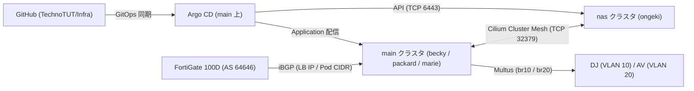

[TechnoTUT Network](/) では、コンテナ型の仮想化手法を採用し、計算資源を提供しています。  
コンテナ型仮想化は、Linux カーネルの機能を利用してプロセスを隔離する方式です。Linux カーネルを共有することで、仮想マシンよりも軽量で高速に動作します。
TechnoTUT Network では、Kubernetes をコンテナオーケストレーションツールとして採用しています。Infrastructure as Code (IaC) による運用が可能であり、運用の効率化を実現します。

構築方法については、[Kubernetes (k8s) 構築方法](/computing/deploy)を参照してください。

## Kubernetes とは
Kubernetesは、複数サーバで複数のコンテナを管理するためのツールです。  
TechnoTUTでは、以下のリポジトリでKubernetesの管理を行っています。  
<RepoCard repo="TechnoTUT/Infra" />

## クラスタ構成

Kubernetes のクラスタは 2 つあります。3 台の物理サーバ (`becky`, `packard`, `marie`) で構成する `main` と、`ongeki` で動く `nas` です。2 つのクラスタは **Cilium Cluster Mesh** でつないでいます。`becky`, `packard`, `marie` には Debian 13 が、`ongeki` には AlmaLinux 10 がインストールされ、`kubeadm` でクラスタが構築されています。

| Node | OS | CPU | Memory | IP Address | Role |
| :--- | :--- | :--- | :--- | :--- | :--- |
| `becky` | Debian 13 | 4 CPU | 8 GB | `192.168.99.200/25` | `main` Control-Plane / NFS サーバ (`/nfs`) |
| `packard` | Debian 13 | 4 CPU | 12 GB | `192.168.99.201/25` | `main` Worker |
| `marie` | Debian 13 | 4 CPU | 12 GB | `192.168.99.202/25` | `main` Worker |
| `ongeki` | AlmaLinux 10 | 4 CPU | 8 GB | `192.168.98.2/30` | `nas` Control-Plane 兼 Worker (Local PV `/nas`) |

Control-Plane ノードは、API サーバ・スケジューラ・コントローラマネージャなどの制御コンポーネントを実行し、Worker ノードはアプリケーションの Pod を実行します。

## 技術スタック

バージョンや CIDR などのパラメータは [k8s/ansible/inventory/group_vars/all/main.yml](https://github.com/TechnoTUT/Infra/blob/main/k8s/ansible/inventory/group_vars/all/main.yml) に集約しています。

| 領域 | 採用技術 | バージョン / 設定 | 用途・特徴 |
| :--- | :--- | :--- | :--- |
| オーケストレーション | Kubernetes (`kubeadm`) | `1.37` | クラスタ構築・ライフサイクル管理 |
| コンテナランタイム | `containerd` | Docker リポジトリ (`containerd.io`) | CRI ランタイム |
| CNI / BGP / Ingress | Cilium | `1.20.4` | `kube-proxy` 置き換え、Native Routing、iBGP による LoadBalancer IP / Pod CIDR 広報、Ingress、Cluster Mesh |
| L2 マルチホーム | Multus | `v4.3.1` | `br10` / `br20` 経由で Pod を VLAN 10 (PRO DJ LINK)・VLAN 20 (Ableton Link) へ直結 |
| ストレージ | NFS / Local PV | `nfs-subdir-external-provisioner` (`4.0.18`) | `becky` の `/nfs` を動的プロビジョニング、`ongeki` は `/nas` を Local PV として利用 |
| 内部 DNS | `bind9` + ExternalDNS | - | `svc.technotut.net` ゾーンを管理し、FortiGate からの DNS 転送を受信 (`10.12.0.0`) |
| GitOps | Argo CD | Helm Chart `10.12.1` | `main` ブランチの `k8s/manifest/` を自動同期 (`root` Application で各アプリを管理) |
| CI Runner | Actions Runner Controller | `0.15.1` | GitHub Actions の self-hosted runner をジョブ実行時のみ Pod として起動 |

## 構築と運用の仕組み

クラスタの構築・設定反映は [k8s/ansible/](https://github.com/TechnoTUT/Infra/tree/main/k8s/ansible) の Ansible Playbook で自動化し、アプリケーションのデプロイは Argo CD による GitOps で行います。

### Ansible による基盤構築
管理用マシンから SSH で実行し、ノードには Ansible をインストールしません。Playbook (`playbooks/site.yml`) は冪等に設計されており、設定変更時も同じコマンドで差分のみ反映できます。

| ロール | 対象 | 役割 |
| :--- | :--- | :--- |
| `network` | `main` 全ノード | VLAN 10・20 とブリッジ (`br10`, `br20`) の構成 |
| `common` | 全ノード | DNS 固定、swap 無効化、カーネルモジュール・sysctl 設定、NFS クライアント導入 |
| `containerd` | 全ノード | `containerd.io` の導入と設定 |
| `nas` | `ongeki` | `/nas` の確認、ホスト Samba 停止、SELinux コンテキスト設定 |
| `nfs` | `becky` | NFS サーバ (`/nfs`) の構築 |
| `kubeadm` | 全ノード | `kubelet` / `kubeadm` / `kubectl` 導入、`kubeadm init` / `join` |
| `addons` | Control-Plane | Helm、Cilium、Multus、NFS Provisioner、Argo CD、`bind9` / ExternalDNS の導入 |

詳細な手順は [Kubernetes (k8s) 構築方法](/computing/deploy) を参照してください。実機を使わずに Podman 上で Playbook を検証するテスト手順は [Podman による疑似クラスタテスト](/computing/test) にまとめています。

### Argo CD による GitOps
Argo CD はリポジトリの `main` ブランチを監視しており、`k8s/manifest/apps/` や各アプリのマニフェストを更新してマージすると自動で同期されます。`nas` クラスタのアプリも `main` クラスタ上の Argo CD から管理しています。\
https://cd.svc.technotut.net/
