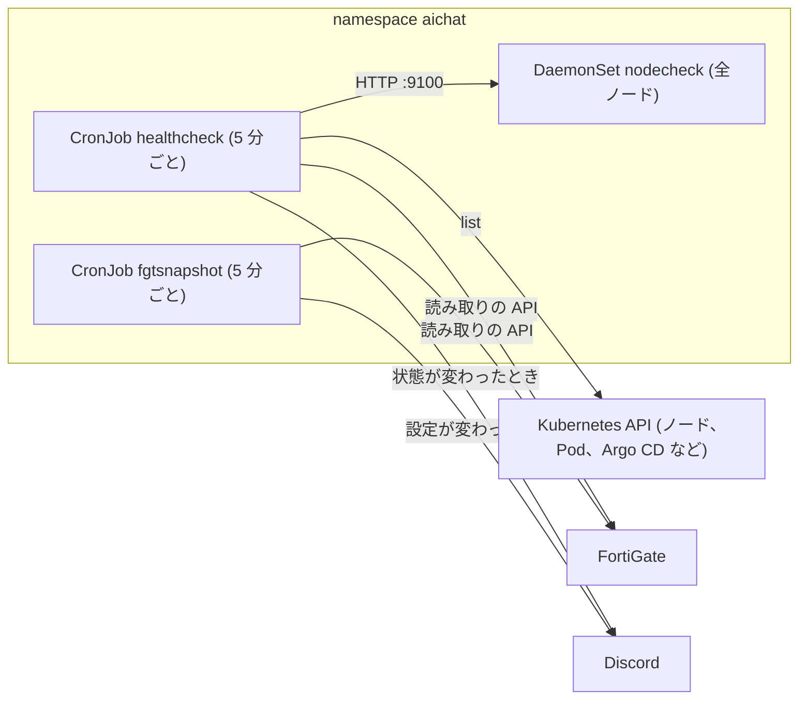

## 概要
クラスタ、ノード、FortiGate を 5 分ごとに自動で確認して、**状態が変わったとき**だけ Discord に通知します。AI (Gemini) は使わないので、トークンを消費しません。LLM を使うのは、人が質問したときの [AI チャット](/computing/aichat) だけです。



| 仕組み | 内容 | 間隔 |
|---|---|---|
| `healthcheck` | 問題を探して、新しい問題・悪化・復旧を通知する | 5 分 |
| `nodecheck` | ノードの事実 (`resolv.conf`、USB デバイス、ディスク) を返す。判定は `healthcheck` | 常駐 |
| `fgtsnapshot` | FortiGate の設定の表を取って、前回との差を通知する | 5 分 |

ソースは [TechnoTUT/infra-assistant](https://github.com/TechnoTUT/infra-assistant) (`app/healthcheck.py`、`app/nodecheck.py`、`app/fgtsnapshot.py`、`app/fortigate.py`)、マニフェストは [`k8s/manifest/aichat/`](https://github.com/TechnoTUT/Infra/tree/main/k8s/manifest/aichat) (`healthcheck.yaml`、`nodecheck.yaml`、`fgtsnapshot.yaml`) です。チャットと同じイメージを、コマンドを変えて動かします。

## 通知のルール
- **新しい問題**: 問題ごとに決めた時間が続いたときに、1 回だけ通知します。起動直後などの一時的な状態は通知しません。
- **悪化**: 通知済みの問題の重大度が、警告から重大に上がったときに通知します。下がったときは通知しません。通知した最高の重大度を覚えているので、行き来しても繰り返し通知しません。
- **復旧**: 問題が消えたときに、続いた時間つきで通知します。
- 同じ状態が続いているあいだは、**再通知しません**。必要なら環境変数 `RENOTIFY_SECONDS` (秒) を設定すると、その間隔で再通知します (既定は 0 = しない)。
- 1 回の実行で見つけたものは、1 つの Discord メッセージにまとめます。状態 (いつから悪いか、通知したか) は ConfigMap `healthcheck-state` に持ちます。
- 通知に失敗したときは状態を保存しないので、次の実行でもう一度通知します。

## ヘルスチェックの内容
| 見るもの | 通知する条件 (続いた時間) | 重大度 |
|---|---|---|
| ノード | NotReady (2 分)、メモリ・ディスク・PID の圧迫 (2 分) | NotReady は重大 |
| Pod | CrashLoopBackOff、ImagePullBackOff などの起動の失敗 (5 分)、Pending や Ready にならない (5 分)、持ち主のない Pod の Failed (5 分) | 起動の失敗は重大 |
| PVC / Service | PVC が Pending (5 分)、LoadBalancer に IP が付かない (5 分) | 警告 |
| Argo CD | Degraded などの異常 (10 分)、OutOfSync (10 分)、アプリの Error 条件 (10 分) | Degraded は重大 |
| CronJob | `healthcheck`、`fgtsnapshot` などの直近の実行が失敗して、その後に成功していない | 警告 |
| ノードの設定 | `/etc/resolv.conf` の nameserver が期待値 (`192.168.99.129`) でない (2 分)、`packard` に `/dev/ttyUSB0` がない (5 分)、ディスクの空きが 10% 未満 (5 分) | `resolv.conf` は重大 |
| ネットワーク | Pod から外部の名前 (`github.com`) と `ai.svc.technotut.net` が引けない (2 分)、`https://github.com` に届かない (2 分) | 名前が引けないのは重大 |
| FortiGate | API に届かない (2 分)、CPU・メモリが 90% 以上 (5 分) | 警告 |

- 一時的な状態を拾わないよう、Pod は持ち主 (Deployment など) の名前でまとめます。Pod が作り直されて名前が変わっても、同じ問題として扱います。
- チェックごとに例外を捕まえます。1 つのチェックが失敗しても (RBAC の不足など)、ほかのチェックと通知は止まらず、「このチェックが実行できない」という問題として通知します。
- 期待値と間隔は、CronJob の環境変数で変えます: `EXPECT_NODE_DNS`、`EXPECT_NODE_DEVICES` (`ノード=/dev/xxx` を `;` 区切り)、`MIN_DISK_FREE_PERCENT`、`FORTIGATE_MAX_PERCENT`、`AGE_NODE`、`AGE_POD`、`AGE_APP`、`AGE_NET`、`DNS_NAMES`、`HTTP_URLS`。

### 権限
ServiceAccount `healthcheck` に、ClusterRole `healthcheck-readonly` を与えています。

- ノード、Pod、PVC、Service、Argo CD の Application、Job、CronJob の `list` だけです。Secret や書き込みは含みません。
- 状態の ConfigMap `healthcheck-state` だけ、`get` と `update` ができます (作成は、この namespace の ConfigMap に限る)。

## nodecheck (ノードの設定のズレ)
ノードの設定は、Kubernetes の API からは見えません。そこで DaemonSet `nodecheck` を全ノード (control-plane を含む) に置いて、事実だけを JSON (`GET :9100/status`) で返させます。

| 項目 | 内容 |
|---|---|
| 返すもの | `resolv.conf` の nameserver、`/dev/ttyUSB*` と `/dev/ttyACM*`、ディスクの空き、負荷 |
| ホストの見え方 | `/etc` と `/dev` を hostPath で、**読み取り専用**でマウント |
| 権限 | 非 root (UID 65533)、capability なし、ServiceAccount のトークンなし |
| 判定 | `healthcheck` が各 Pod にアクセスして、期待値と比べる |

2026-11-19 に、ノードの VLAN 設定 (`br10`) を外したときに、ノードの `/etc/resolv.conf` が空になって、クラスタ全体の外部 DNS が止まりました。この種の設定のズレを検知するための仕組みです。ノードの DNS は FortiGate (`192.168.99.129`) に固定しています ([DHCP・DNS](/network/fw#dhcpdns))。

## FortiGate の設定の変更検知 (fgtsnapshot)
FortiGate の設定ファイルの取得 (backup) には、メンテナンスの権限が要ります。強すぎるので、読み取り専用のユーザーには与えていません。代わりに、設定の主要な表を読み取りの API で取って、前回との差を通知します。

- 対象の表: ポリシー、アドレス、サービス、インターフェース、VXLAN、software switch、DHCP サーバ、DNS サーバ、DNS データベース、静的経路。管理者、API ユーザー、証明書は取りません。
- スナップショットは、gzip して ConfigMap `fortigate-snapshot` に持ちます (約 24 KB)。最初の実行は、基準を作るだけで通知しません。
- 差は、`+` (追加)、`-` (削除)、`~` (変更。`項目: 前 → 後`) の行で通知します。パスワードや鍵らしい項目の値は伏せます。fortigate-operator による変更も、手で変えた変更も、区別せずに通知します。
- 通知に失敗したときは、基準を更新しないので、次の実行でもう一度通知します。

## FortiGate の API ユーザー
| 項目 | 内容 |
|---|---|
| ユーザー | `infra-readonly` (プロファイル `readonly-api`)。読み取りだけ |
| 接続元 | trusthost は dmz の `192.168.99.128/25`。Pod の通信は、ノードの IP に NAT されて届く |
| トークン | Secret `aichat/fortigate-readonly` (キー `token`)。Ansible Vault の `vault_fortigate_readonly_token` から、`aichat.yml` が作る |
| 使うもの | AI チャットの FortiGate のツール、`healthcheck`、`fgtsnapshot` |

読める path は `app/fortigate.py` の許可リストに限っています。FortiOS 6.2 には、ARP の API がなく (404)、`resource/usage` の値がリストで返るなどの癖があります。新しい項目を読むときは、許可リストに足します。fortigate-operator と ExternalDNS の API ユーザーとは別のものです。

## 運用
### 手元で確認する
```bash
# 通知も状態の保存もしないで、今の問題を表示する (クラスタの kubeconfig が必要)
DRY_RUN=1 python -m app.healthcheck
DRY_RUN=1 python -m app.fgtsnapshot
```
本番では、CronJob から Job を 1 つ作って、ログを見ます (`kubectl -n aichat create job hc-test --from=cronjob/healthcheck`)。

### 更新する
1. infra-assistant の main にマージして、GitHub Actions がイメージをビルドするのを待ちます。
2. `k8s/manifest/aichat/` の `healthcheck.yaml`、`fgtsnapshot.yaml` (`nodecheck.yaml` は、`app/nodecheck.py` を変えたときだけ) の `image:` のタグを、新しい `sha-<コミット 7 桁>` に変えます。
3. PR をマージします。

`:main` ではなくコミットのタグに固定しているのは、WAN が不安定なときも監視を動かすためです (ノードにあるイメージを使う `IfNotPresent`)。`:main` だと、ノードに古いイメージが残ったまま、新しいコードが動きません。

### 通知が来ないとき
- `kubectl -n aichat get cronjob,job` で、最近の Job が成功しているか見ます。失敗していれば、`kubectl -n aichat logs job/<名前>`。
- Secret `aichat` に `discord-webhook-url` がないと、通知は出ません (ログに「DISCORD_WEBHOOK_URL が未設定」と出ます)。
- 状態を消して、すべての問題をもう一度通知させたいときは、ConfigMap `healthcheck-state` を削除します。

## 見ていないもの
- VLAN の側からの疎通 (ゲートウェイや DHCP が VLAN で生きているか)。Pod を起動するので、定期には回していません。AI チャットの `vlan_probe` で、必要なときに調べます。
- アプリの中身 (配信が流れているか、DJ 機器を検出しているかなど)。
- 証明書の期限、データのバックアップ (plmux の SQLite、etcd、NAS の共有)。
