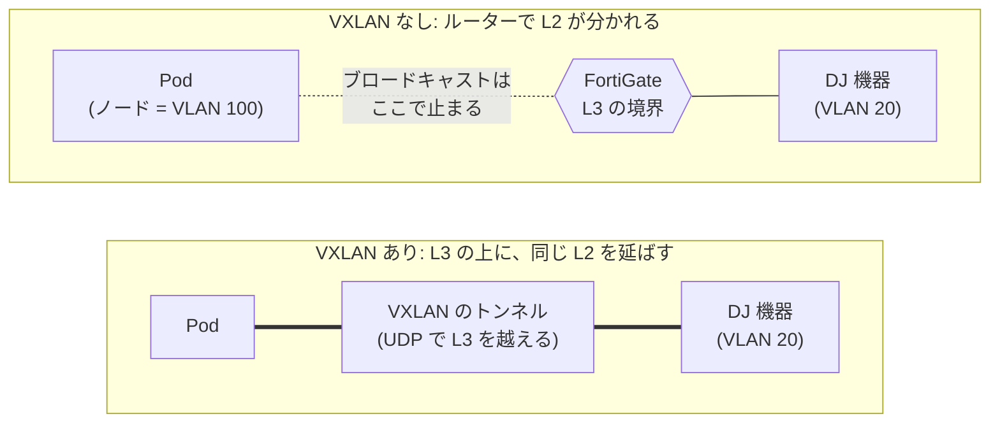
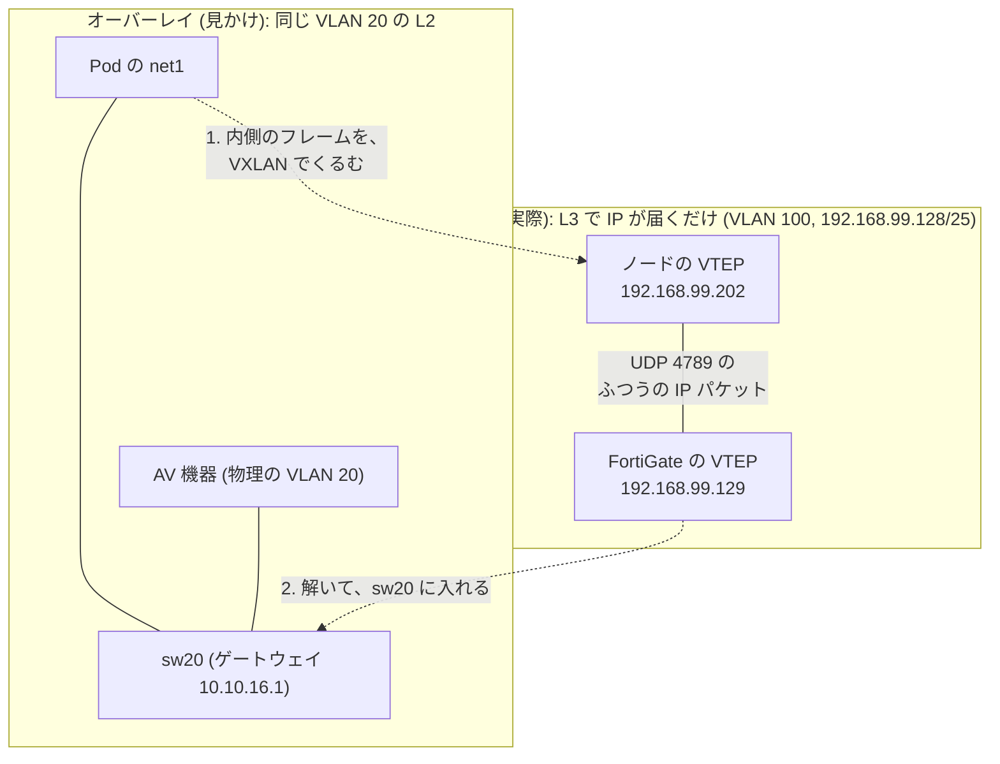
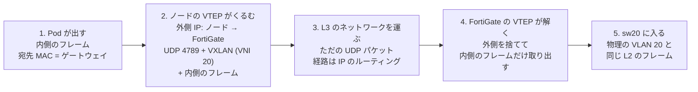
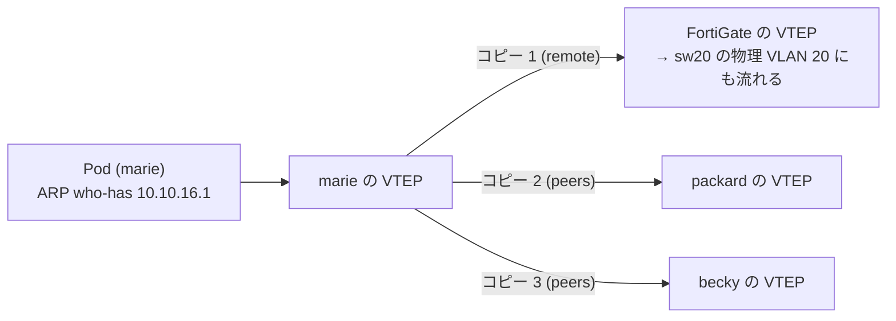
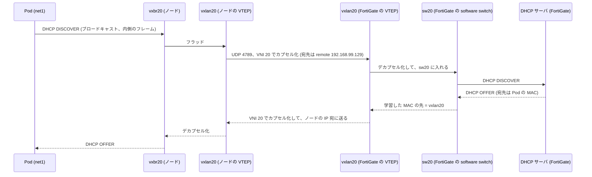
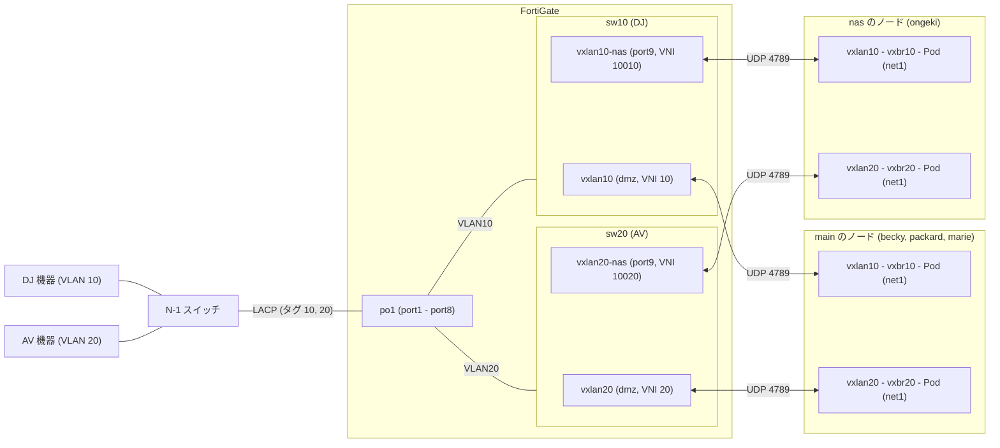

Kubernetes の Pod を VLAN 10 (DJ)・20 (AV)・30 (LBAR)・40 (PA)・42 (ENT)・43 (LDISP)・44 (CAM1)・45 (CAM2) へ L2 で直接接続するため、FortiGate とノードの間に VXLAN を採用しています。ノード側は CNI プラグイン [vxlan-cni](https://github.com/TechnoTUT/vxlan-cni) が、FortiGate 側は software switch が担当します。本書は、その全体構成と各部の設定を整理したものです。Pod の使用方法と VLAN の追加手順は [Kubernetes 構築方法](/computing/deploy) を参照してください。

## VXLAN のプロトコル
このページの構成を読むための、VXLAN (Virtual eXtensible LAN、[RFC 7348](https://datatracker.ietf.org/doc/html/rfc7348)) の基礎です。

### VXLAN とは
Ethernet のフレームを丸ごと UDP でくるんで、IP ネットワークの上で運ぶ仕組みです。離れた場所の機器を、同じ L2 (同じブロードキャストドメイン) につなげます。VLAN のタグを、ケーブルや L2 スイッチを越えて運べない場所でも、IP が届けば同じ VLAN を延ばせます。

| 用語 | 意味 | この環境での例 |
| :--- | :--- | :--- |
| VNI (VXLAN Network Identifier) | VXLAN のセグメントの番号。24 ビット (約 1677 万)。VLAN ID は 12 ビット (4094) | VLAN 20 の VNI は main が `20`、nas が `10020` |
| VTEP (VXLAN Tunnel End Point) | フレームをくるむ (カプセル化) と、解く (デカプセル化) 場所 | 各ノード (`vxlan20`)、FortiGate (`vxlan20`) |
| アンダーレイ | VXLAN のパケットを運ぶ、外側の IP ネットワーク | サーバ用の VLAN 100 (`dmz`、`192.168.99.128/25`) |
| オーバーレイ | VXLAN の中を流れる、内側の L2 | VLAN 20 の Pod と機器 (`sw20`) |

### なぜ L3 の上に L2 を作るのか
DJ 機器の PRO DJ LINK や、Ableton Link、ARP、DHCP は、**同じ L2 (ブロードキャストドメイン) の中**でしか届かない通信です。ところが、Kubernetes のノードは、サーバ用のネットワーク (VLAN 100) にいて、DJ や AV の機器がいる VLAN 10・20 とは、FortiGate (L3 のルーター) を挟んで別の場所にいます。ルーターは、ブロードキャストを越えさせません。



VXLAN は、ルーターを越えて IP で届く経路の上に、「見かけ上の L2」(オーバーレイ) を作ります。Pod は、物理の VLAN 20 に接続した機器と、同じ L2 にいるように通信できます。



- 上の図の「実際」の部分には、L2 の機器は出てきません。ノードと FortiGate が、IP で通信できればよいだけです。
- 「見かけ」の L2 は、VNI (VLAN 20 なら `20`) で区別されます。VNI が違えば、別の L2 です。

### カプセル化の流れ
Pod が出した 1 つのフレームが、L3 を越えて届くまでを追います。



途中のルーターは、外側の IP ヘッダーだけを見ます。内側のフレーム (Pod の MAC や VLAN 20 の中身) は、運ばれているだけで、見ません。

### パケットの構造
内側のフレームの前に、VXLAN ヘッダー (8 バイト)、UDP、IP、Ethernet を付けて送ります。

```
+----------------+-----------+----------+-----------+-------------------------------------+
| 外側 Ethernet  | 外側 IP   | UDP      | VXLAN     | 内側の Ethernet フレーム            |
| 14 B           | 20 B      | 8 B      | 8 B       | 14 B (ヘッダー) + IP パケットなど   |
|                |           | 宛先 4789|           |  <- 元のフレーム (Pod や機器が出した) |
+----------------+-----------+----------+-----------+-------------------------------------+
```

VXLAN ヘッダー (8 バイト) の中身は次のとおりです。

| フィールド | サイズ | 内容 |
| :--- | :--- | :--- |
| Flags | 8 ビット | `I` ビット (0x08) が 1 のとき、VNI が有効 |
| 予約 | 24 ビット | 0 |
| VNI | 24 ビット | セグメントの番号 |
| 予約 | 8 ビット | 0 |

- UDP の宛先ポートは **4789** (IANA で割り当て済み) です。送信元ポートは、内側のフレームのヘッダーから計算して散らします。経路上の機器が、同じ通信を同じ経路で運べるようにするためです。
- 外側の Ethernet は、IP の経路上で毎回付け替わります。内側のフレームは、そのまま運ばれます。
- VXLAN には、暗号化も認証もありません。経路上で見られるので、信頼できるネットワーク (ここではサーバ用の VLAN 100) の中だけで使います。

#### MTU
外側の IP パケットが 1500 バイトに収まるように、内側の IP パケットの MTU を小さくします。

```
内側の IP の MTU = 1500 (外側の MTU)
                 - 20 (外側 IP) - 8 (UDP) - 8 (VXLAN) - 14 (内側 Ethernet)
                 = 1450
```

この環境の VXLAN インターフェースとブリッジ、Pod の `net1` は、すべて MTU 1450 です。これより大きなパケットは、断片化されるか、捨てられます (DF ビットが立っているとき)。TCP は、MSS を調整して小さなパケットで通信します。UDP で 1450 バイトを超えるものを送る機器は、つながりにくくなります。

### 転送の仕組み
VTEP は、L2 スイッチと同じように、MAC アドレスを学習して転送します (フラッド・アンド・ラーン)。

1. **学習**: 受け取ったフレームの送信元 MAC を、「この MAC は、この VTEP の先にいる」と記録します (FDB)。記録は 300 秒 (`ageing 300`) で消えます。
2. **既知のユニキャスト**: 宛先 MAC を学習済みなら、その VTEP だけに送ります。
3. **BUM** (ブロードキャスト、不明なユニキャスト、マルチキャスト): 宛先が分からないフレームや、ARP、DHCP などのブロードキャストは、すべての相手の VTEP に送ります。RFC 7348 は、アンダーレイの IP マルチキャストで配る方法を定めています。この環境は、マルチキャストを使わず、**宛先の VTEP のリストに、同じフレームをユニキャストで複製して送ります** (head-end replication)。
4. **ループの防止**: VXLAN から受け取ったフレームは、ほかの VXLAN の相手 (VTEP) には転送しません (スプリットホライズン)。

複製のイメージは次のとおりです (Pod が ARP のブロードキャストを出したとき)。ノードは、FortiGate (`remote`) と、NAD の `peers` に登録したほかの全ノードに、ユニキャストで同じフレームを送ります (そのノードに同じ VLAN の Pod がいるかどうかは関係ありません)。



宛先の数だけ複製するので、ブロードキャストが多い VLAN、VTEP が多い構成ほど、負荷が増えます。VXLAN のカプセル化と複製は、FortiGate 100D では CPU で処理されます (「運用上の制約」を参照)。

#### この環境での対応
| 役割 | 実装 | 設定 |
| :--- | :--- | :--- |
| ノードの VTEP | Linux の VXLAN デバイス `vxlan<VLAN>` (vxlan-cni が作る) | `vxlan id <VNI> remote 192.168.99.129 local <ノードの IP> dev <NIC>.100 dstport 4789 ageing 300` |
| ノードのブリッジ | Linux のブリッジ `vxbr<VLAN>` (学習 `learning on`、フラッド `flood on`) | Pod の `net1` (veth) と `vxlan<VLAN>` をつなぐ。MTU 1450 |
| FortiGate の VTEP | `config system vxlan` の `vxlan<VLAN>` (`dmz` に紐づけ) | `vni`、`remote-ip` (複製先の VTEP のリスト = main の各ノード) |
| FortiGate のブリッジ | software switch `sw<VLAN>` | VLAN インターフェースと `vxlan<VLAN>`、`vxlan<VLAN>-nas` をまとめる。MAC を学習して転送する |
| ノードどうしの直接通信 | NAD の `peers` | FortiGate は同じ VXLAN インターフェースの相手どうしを中継しないので、ノード同士が直接 VXLAN で送る |

#### 例: Pod が DHCP でアドレスを取る


DHCP のあとの通信 (ゲートウェイの ARP、通常の IP の通信) も、同じ経路を、学習した MAC に従って運びます。ゲートウェイは `sw20` の IP (`10.10.16.1`) で、物理の VLAN 20 の機器と Pod は、同じ `sw20` の中にいます。

### トラブルシュートのポイント
| 症状 | 確認すること |
| :--- | :--- |
| Pod に IP が付かない (DHCP が取れない) | VNI がノードと FortiGate で一致しているか。FortiGate の `vxlan<VLAN>` の `remote-ip` に、そのノードが入っているか。DHCP サーバが `sw<VLAN>` にあるか (VLAN 30 にはない) |
| 小さい通信はできるが、大きい通信が止まる | MTU。内側が 1450 を超えていないか。外側 (`<NIC>.100`、`dmz`) が 1500 か |
| 同じ VLAN の機器と通信できない | UDP 4789 が、ノードと FortiGate の間 (VLAN 100) で届くか。ゲートウェイの MAC が変わっていないか (software switch は、メンバーのうち最小の MAC を使う) |
| ノードを足したら Pod が届かない | NAD の `peers` と、FortiGate の `remote-ip` に、新しいノードを足したか |

VXLAN のパケットは、ノードの NIC で見られます。`tcpdump` は VXLAN を解釈して、VNI と内側のフレームを表示します。
```bash
# ノードで (アンダーレイは VLAN 100 のインターフェース。becky は eno1.100、packard と marie は enp2s0.100)
sudo tcpdump -ni enp2s0.100 -vv udp port 4789
# 出力の例: VXLAN, flags [I] (0x08), vni 20  ... 内側の Ethernet と ARP / IP
```
Wireshark では、表示フィルタ `vxlan.vni == 20` が使えます。

## 全体構成


- 各 VLAN の機器と Pod は、同一のブロードキャストドメイン (`sw10`, `sw20`, `sw30`, `sw40`, `sw42` - `sw45`) に所属します。ゲートウェイ、DHCP サーバ、DNS サーバ、ポリシーは software switch が保持します。
- ノードのトランクや VLAN インターフェースは不要です。VLAN は VXLAN の VNI として伝送します。
- 以前の Multus の `vlan10-bridge`・`vlan20-bridge` (トランクと br10・br20) は廃止しました。plmux を含め、すべての Pod は vxlan-cni でつなぎます。

## VNI の割当
VNI は `VLAN ID + vniOffset` で決定します。VLAN 30・40・42〜45 も同じ規則です (例: VLAN 44 は main が 44、nas が 10044)。

| クラスタ | FortiGate 側のインターフェース | VTEP の IP アドレス (`remote`) | `vniOffset` | VLAN 10 の VNI | VLAN 20 の VNI |
|---|---|---|---|---|---|
| main | `dmz` (`vxlan10`, `vxlan20`) | `192.168.99.129` | 0 | 10 | 20 |
| nas | `port9` (`vxlan10-nas`, `vxlan20-nas`) | `192.168.98.1` | 10000 | 10010 | 10020 |

nas に別系統の VNI を使用する理由は、FortiGate の仕様上の制約です。

- VNI 一つにつき、VXLAN インターフェースを一つしか作成できない。
- VXLAN インターフェースは、紐付けた物理インターフェース (`dmz` か `port9`) からのみ、カプセル化したパケットを送出する。

main と nas の Pod 間の通信は、同一の software switch に所属する構成員 (`vxlan10` と `vxlan10-nas` など) として、FortiGate が中継します。

## ノード側 (vxlan-cni)
<RepoCard repo="TechnoTUT/vxlan-cni" />

### 導入
Ansible の次のロールが導入を担当します。変数は `k8s/ansible/inventory/group_vars/all/main.yml` に定義し、nas は `nas_cluster.yml` で上書きします。

| ロール | 内容 |
|---|---|
| `vxlan_cni` | `/opt/cni/bin/vxlan` を GitHub のリリースから取得 (`vxlan_cni_version`、SHA256 で検証)。`dhcp` プラグインの常駐プロセス `cni-dhcp.service` を全ノードに配置 |
| `addons` | NAD `kube-public/vxlan` を作成 |

`dhcp` プラグインは `kubernetes-cni` のパッケージが `/opt/cni/bin/dhcp` に配置します。不在の場合、ロールは即時中断します。

| 変数 | 既定値 | 意味 |
|---|---|---|
| `vxlan_cni_enabled` | `true` | ロールと NAD の有効化 |
| `vxlan_cni_version` | `v0.2.0` | プラグインの版数 (`vxlan_cni_sha256` と同時に更新) |
| `vxlan_cni_remote` | `192.168.99.129` | FortiGate 側の VTEP。nas は `192.168.98.1` |
| `vxlan_cni_vni_offset` | `0` | VNI = VLAN ID + 本値。nas は `10000` |
| `vxlan_cni_allowed_vlans` | `[10, 20, 30, 40, 42, 43, 44, 45]` | Pod が選択可能な VLAN。FortiGate に VXLAN と software switch を作成済みの VLAN だけを入れる。空の場合は NAD を非配置 |
| `vxlan_cni_nad_name` / `vxlan_cni_nad_namespace` | `vxlan` / `kube-public` | NAD の名称と namespace |

### NAD
NAD は全 VLAN 共通の一つのみです (雛形は `k8s/ansible/roles/addons/templates/nad-vxlan.yaml.j2`)。

```json
{
  "cniVersion": "1.0.0",
  "name": "vxlan",
  "type": "vxlan",
  "remote": "192.168.99.129",
  "vniOffset": 0,
  "peers": ["<main の全ノードの node_ip>"],
  "allowedVlans": [10, 20, 30, 40, 42, 43, 44, 45],
  "ipam": { "type": "dhcp" }
}
```

| キー | 内容 |
|---|---|
| `remote` | FortiGate 側の VTEP の IP アドレス |
| `vniOffset` | VNI の加算値 |
| `peers` | 同一 VXLAN 上の対向ノードの IP (`k8s` グループの `node_ip`)。詳細は「ノード間通信」を参照 |
| `allowedVlans` | `cni-args` の `vlan` に指定可能な値。範囲外はプラグインが拒否 |
| `ipam` | `dhcp`。VLAN の DHCP サーバ (FortiGate) から IP アドレスを取得 |

VLAN 30 (LBAR) は、FortiGate に DHCP サーバがありません (静的割り当て)。Pod をつなぐと、`ipam: dhcp` で IP アドレスが付きません。VLAN 30 に Pod を置くときは、FortiGate に DHCP サーバを足します。\
NAD だけを作り直す (`vxlan_cni_allowed_vlans` や `peers` を変えたとき) には、`site.yml` 全体を流さずに、次を main と nas のそれぞれの inventory で実行します。
```bash
cd k8s/ansible
ansible control_plane -i inventory/hosts.yml -m ansible.builtin.include_role -a "name=addons tasks_from=vxlan-nad"
ansible control_plane -i inventory/nas.yml   -m ansible.builtin.include_role -a "name=addons tasks_from=vxlan-nad"
```

### Pod での指定
```yaml
metadata:
  annotations:
    k8s.v1.cni.cncf.io/networks: |
      [{ "name": "vxlan", "namespace": "kube-public", "cni-args": { "vlan": 20 } }]
```

Pod には `eth0` (Cilium) に加えて `net1` が付与されます。

### Pod 作成時のノードの動作
1. Multus が `vxlan` プラグインを呼出。
2. プラグインがノード上に `vxlan<VLAN>` (VXLAN インターフェース) とブリッジ `vxbr<VLAN>` を作成。既存の場合は再利用。
3. Pod の `net1` (veth) を `vxbr<VLAN>` に接続。MTU は 1450。
4. `dhcp` IPAM が `cni-dhcp.service` を介して、Pod の netns 内で DHCP を実行。
5. 当該 VLAN の Pod がノードから消滅すると、`vxlan<VLAN>` と `vxbr<VLAN>` を撤去。

DHCP 応答に含まれる既定経路は破棄します。Pod の既定経路は、従来どおり Cilium の `eth0` です。

### MTU
MTU は 1450 です。`dmz` と `port9` の MTU 1500 から、VXLAN の付加情報 (50 バイト) を差引いた値です。

### ノード間通信
FortiGate は、同一の VXLAN インターフェースに属する対向どうしの通信を中継しません。したがって、main の別ノード間の Pod 通信は、`peers` に登録したノードの IP 宛に、ノード同士が直接 VXLAN で送受信します。ノードの増設時は `peers` が変動するため、`site.yml` を実行して NAD を更新し、FortiGate の `remote-ip` も更新します。

## FortiGate 側
実際の設定は `network/config/FG100D.txt` に記録しています。

```
config system vxlan
    edit "vxlan10"
        set interface "dmz"
        set vni 10
        set remote-ip "192.168.99.200" "192.168.99.201" "192.168.99.202"
    next
    edit "vxlan10-nas"
        set interface "port9"
        set vni 10010
        set remote-ip "192.168.98.2"
    next
    edit "vxlan20"
        set interface "dmz"
        set vni 20
        set remote-ip "192.168.99.200" "192.168.99.201" "192.168.99.202"
    next
    edit "vxlan20-nas"
        set interface "port9"
        set vni 10020
        set remote-ip "192.168.98.2"
    next
end
config system switch-interface
    edit "sw10"
        set vdom "root"
        set member "VLAN10" "vxlan10" "vxlan10-nas"
    next
    edit "sw20"
        set vdom "root"
        set member "VLAN20" "vxlan20" "vxlan20-nas"
    next
end
```

| software switch | IP アドレス | 構成員 |
|---|---|---|
| `sw10` (DJ) | `10.10.0.1/20` | `VLAN10`、`vxlan10`、`vxlan10-nas` |
| `sw20` (AV) | `10.10.16.1/20` | `VLAN20`、`vxlan20`、`vxlan20-nas` |
| `sw30` (LBAR) | `192.168.11.1/24` | `VLAN30`、`vxlan30`、`vxlan30-nas` (DHCP サーバなし) |
| `sw40` (PA) | `192.168.12.1/27` | `VLAN40`、`vxlan40`、`vxlan40-nas` |
| `sw42` (ENTRANCE) | `192.168.12.33/28` | `VLAN42`、`vxlan42`、`vxlan42-nas` |
| `sw43` (LDISP) | `192.168.12.49/28` | `VLAN43`、`vxlan43`、`vxlan43-nas` |
| `sw44` (CAM1) | `192.168.12.65/28` | `VLAN44`、`vxlan44`、`vxlan44-nas` |
| `sw45` (CAM2) | `192.168.12.81/28` | `VLAN45`、`vxlan45`、`vxlan45-nas` |

- `remote-ip` の `192.168.99.200` - `202` は main のノード (becky, packard, marie)、`192.168.98.2` は nas のノード (ongeki) です。
- ポリシーと DHCP・DNS サーバは software switch (`sw10`, `sw20`) に設定します。ポリシーの対象アドレスは `VLAN10 subnet` など、VLAN ごとの `VLANnn subnet` (ipmask) です。
- software switch は、構成員のうち最小の MAC をゲートウェイの MAC に採用します。構成員の増減でゲートウェイの MAC が変化するため、端末の ARP キャッシュの更新が必須となります。

## 運用上の制約
- 使用中 (software switch の構成員) の VXLAN インターフェースは、`remote-ip` を変更できません。ノード増設時は、一旦 software switch から切離し、変更後に再度組込みます。この間、VXLAN 上の Pod 通信は一時停止します。
- VXLAN のカプセル化と software switch の転送は、FortiGate 100D では CPU が処理します。大容量の通信を扱う VLAN に適用する際は、CPU 使用率の監視が必須です。
- Pod が選択可能な VLAN は、FortiGate に VXLAN と software switch を作成済みの VLAN に限定されます。VLAN の追加手順は [Kubernetes 構築方法](/computing/deploy) の「VLAN を追加する手順」を参照してください。

## 動作確認
```bash
# ノード (VTEP とブリッジ)
ip -d link show type vxlan        # vxlan id (VNI)、remote、local、dstport 4789 を見る
ip link show type bridge
bridge fdb show dev vxlan20       # iproute2 の bridge コマンドが入っているノードだけ

# Pod (net1 の IP アドレスと MTU)
kubectl exec <pod> -- ip addr show net1

# DHCP 常駐プロセス
systemctl status cni-dhcp
```

FortiGate 側の確認は次のとおりです。
```
diagnose netlink brctl name host sw20    # software switch の MAC 表
get system arp
```

検証の結果は [vxlan-cni の test/fortigate](https://github.com/TechnoTUT/vxlan-cni/tree/main/test/fortigate) に掲載しています。
