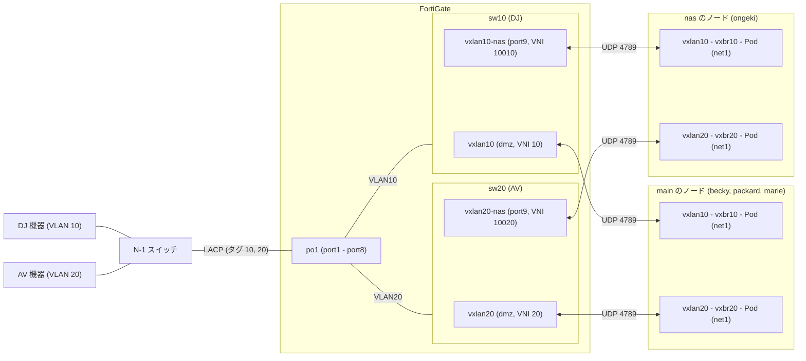

Kubernetes の Pod を VLAN 10 (DJ)・20 (AV) へ L2 で直接接続するため、FortiGate とノードの間に VXLAN を採用しています。ノード側は CNI プラグイン [vxlan-cni](https://github.com/TechnoTUT/vxlan-cni) が、FortiGate 側は software switch が担当します。本書は、その全体構成と各部の設定を整理したものです。Pod の使用方法と VLAN の追加手順は [Kubernetes 構築方法](/computing/deploy) を参照してください。

## 全体構成


- VLAN 10・20 の機器と Pod は、同一のブロードキャストドメイン (`sw10`, `sw20`) に所属します。ゲートウェイ、DHCP サーバ、DNS サーバ、ポリシーは software switch が保持します。
- ノードのトランクや VLAN インターフェースは不要です。VLAN は VXLAN の VNI として伝送します。
- 以前の Multus の `vlan10-bridge`・`vlan20-bridge` (トランクと br10・br20) は廃止しました。plmux を含め、すべての Pod は vxlan-cni でつなぎます。

## VNI の割当
VNI は `VLAN ID + vniOffset` で決定します。

| クラスタ | FortiGate 側のインターフェース | VTEP の IP アドレス (`remote`) | `vniOffset` | VLAN 10 の VNI | VLAN 20 の VNI |
|---|---|---|---|---|---|
| main | `dmz` (`vxlan10`, `vxlan20`) | `192.168.99.129` | 0 | 10 | 20 |
| nas | `port9` (`vxlan10-nas`, `vxlan20-nas`) | `192.168.98.1` | 10000 | 10010 | 10020 |

nas に別系統の VNI を使用する理由は、FortiGate の仕様上の制約です。

- VNI 一つにつき、VXLAN インターフェースを一つしか作成できない。
- VXLAN インターフェースは、紐付けた物理インターフェース (`dmz` か `port9`) からのみ、カプセル化したパケットを送出する。

main と nas の Pod 間の通信は、同一の software switch に所属する構成員 (`vxlan10` と `vxlan10-nas` など) として、FortiGate が中継します。

## ノード側 (vxlan-cni)
<RepoCard repo="TechnoTUT/vxlan-cni" />

### 導入
Ansible の次のロールが導入を担当します。変数は `k8s/ansible/inventory/group_vars/all/main.yml` に定義し、nas は `nas_cluster.yml` で上書きします。

| ロール | 内容 |
|---|---|
| `vxlan_cni` | `/opt/cni/bin/vxlan` を GitHub のリリースから取得 (`vxlan_cni_version`、SHA256 で検証)。`dhcp` プラグインの常駐プロセス `cni-dhcp.service` を全ノードに配置 |
| `addons` | NAD `kube-public/vxlan` を作成 |

`dhcp` プラグインは `kubernetes-cni` のパッケージが `/opt/cni/bin/dhcp` に配置します。不在の場合、ロールは即時中断します。

| 変数 | 既定値 | 意味 |
|---|---|---|
| `vxlan_cni_enabled` | `true` | ロールと NAD の有効化 |
| `vxlan_cni_version` | `v0.2.0` | プラグインの版数 (`vxlan_cni_sha256` と同時に更新) |
| `vxlan_cni_remote` | `192.168.99.129` | FortiGate 側の VTEP。nas は `192.168.98.1` |
| `vxlan_cni_vni_offset` | `0` | VNI = VLAN ID + 本値。nas は `10000` |
| `vxlan_cni_allowed_vlans` | `[10, 20]` | Pod が選択可能な VLAN。空の場合は NAD を非配置 |
| `vxlan_cni_nad_name` / `vxlan_cni_nad_namespace` | `vxlan` / `kube-public` | NAD の名称と namespace |

### NAD
NAD は全 VLAN 共通の一つのみです (雛形は `k8s/ansible/roles/addons/templates/nad-vxlan.yaml.j2`)。

```json
{
  "cniVersion": "1.0.0",
  "name": "vxlan",
  "type": "vxlan",
  "remote": "192.168.99.129",
  "vniOffset": 0,
  "peers": ["<main の全ノードの node_ip>"],
  "allowedVlans": [10, 20],
  "ipam": { "type": "dhcp" }
}
```

| キー | 内容 |
|---|---|
| `remote` | FortiGate 側の VTEP の IP アドレス |
| `vniOffset` | VNI の加算値 |
| `peers` | 同一 VXLAN 上の対向ノードの IP (`k8s` グループの `node_ip`)。詳細は「ノード間通信」を参照 |
| `allowedVlans` | `cni-args` の `vlan` に指定可能な値。範囲外はプラグインが拒否 |
| `ipam` | `dhcp`。VLAN の DHCP サーバ (FortiGate) から IP アドレスを取得 |

### Pod での指定
```yaml
metadata:
  annotations:
    k8s.v1.cni.cncf.io/networks: |
      [{ "name": "vxlan", "namespace": "kube-public", "cni-args": { "vlan": 20 } }]
```

Pod には `eth0` (Cilium) に加えて `net1` が付与されます。

### Pod 作成時のノードの動作
1. Multus が `vxlan` プラグインを呼出。
2. プラグインがノード上に `vxlan<VLAN>` (VXLAN インターフェース) とブリッジ `vxbr<VLAN>` を作成。既存の場合は再利用。
3. Pod の `net1` (veth) を `vxbr<VLAN>` に接続。MTU は 1450。
4. `dhcp` IPAM が `cni-dhcp.service` を介して、Pod の netns 内で DHCP を実行。
5. 当該 VLAN の Pod がノードから消滅すると、`vxlan<VLAN>` と `vxbr<VLAN>` を撤去。

DHCP 応答に含まれる既定経路は破棄します。Pod の既定経路は、従来どおり Cilium の `eth0` です。

### MTU
MTU は 1450 です。`dmz` と `port9` の MTU 1500 から、VXLAN の付加情報 (50 バイト) を差引いた値です。

### ノード間通信
FortiGate は、同一の VXLAN インターフェースに属する対向どうしの通信を中継しません。したがって、main の別ノード間の Pod 通信は、`peers` に登録したノードの IP 宛に、ノード同士が直接 VXLAN で送受信します。ノードの増設時は `peers` が変動するため、`site.yml` を実行して NAD を更新し、FortiGate の `remote-ip` も更新します。

## FortiGate 側
実際の設定は `network/config/FG100D.txt` に記録しています。

```
config system vxlan
    edit "vxlan10"
        set interface "dmz"
        set vni 10
        set remote-ip "192.168.99.200" "192.168.99.201" "192.168.99.202"
    next
    edit "vxlan10-nas"
        set interface "port9"
        set vni 10010
        set remote-ip "192.168.98.2"
    next
    edit "vxlan20"
        set interface "dmz"
        set vni 20
        set remote-ip "192.168.99.200" "192.168.99.201" "192.168.99.202"
    next
    edit "vxlan20-nas"
        set interface "port9"
        set vni 10020
        set remote-ip "192.168.98.2"
    next
end
config system switch-interface
    edit "sw10"
        set vdom "root"
        set member "VLAN10" "vxlan10" "vxlan10-nas"
    next
    edit "sw20"
        set vdom "root"
        set member "VLAN20" "vxlan20" "vxlan20-nas"
    next
end
```

| software switch | IP アドレス | 構成員 |
|---|---|---|
| `sw10` (DJ) | `10.10.0.1/20` | `VLAN10`、`vxlan10`、`vxlan10-nas` |
| `sw20` (AV) | `10.10.16.1/20` | `VLAN20`、`vxlan20`、`vxlan20-nas` |

- `remote-ip` の `192.168.99.200` - `202` は main のノード (becky, packard, marie)、`192.168.98.2` は nas のノード (ongeki) です。
- ポリシーと DHCP・DNS サーバは software switch (`sw10`, `sw20`) に設定します。ポリシーの対象アドレスは `VLAN10 subnet`・`VLAN20 subnet` (ipmask) です。
- software switch は、構成員のうち最小の MAC をゲートウェイの MAC に採用します。構成員の増減でゲートウェイの MAC が変化するため、端末の ARP キャッシュの更新が必須となります。

## 運用上の制約
- 使用中 (software switch の構成員) の VXLAN インターフェースは、`remote-ip` を変更できません。ノード増設時は、一旦 software switch から切離し、変更後に再度組込みます。この間、VXLAN 上の Pod 通信は一時停止します。
- VXLAN のカプセル化と software switch の転送は、FortiGate 100D では CPU が処理します。大容量の通信を扱う VLAN に適用する際は、CPU 使用率の監視が必須です。
- Pod が選択可能な VLAN は、FortiGate に VXLAN と software switch を作成済みの VLAN に限定されます。VLAN の追加手順は [Kubernetes 構築方法](/computing/deploy) の「VLAN を追加する手順」を参照してください。

## 動作確認
```bash
# ノード (VTEP とブリッジ)
ip -d link show type vxlan
ip link show type bridge
bridge fdb show dev vxlan20

# Pod (net1 の IP アドレスと MTU)
kubectl exec <pod> -- ip addr show net1

# DHCP 常駐プロセス
systemctl status cni-dhcp
```

FortiGate 側の確認は次のとおりです。
```
diagnose netlink brctl name host sw20    # software switch の MAC 表
get system arp
```

検証の結果は [vxlan-cni の test/fortigate](https://github.com/TechnoTUT/vxlan-cni/tree/main/test/fortigate) に掲載しています。
