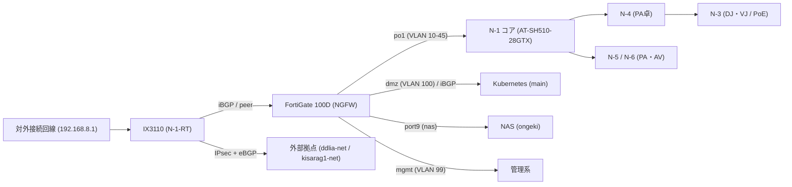

TechnoTUT Networkは、部室及びThe Utopia Tone(学内DJイベント)で利用可能なIPネットワークです。\
音声・映像等のメディアの伝送や会場内に設置された機器のコントロールなど、あらゆる情報を送ることができます。一部のネットワーク機器はPoE(Power over Ethernet)に対応し、機器への電源供給が可能です。

TechnoTUT Networkでは、DJ機器との通信に用いるPRO DJ LINKや、映像伝送プロトコルであるNDI・RTMP、複数デバイスで拍・テンポを同期するAbleton Link、照明制御用のプロトコルであるArt-Net、PAの要であるデジタルミキサーの制御通信などを流すためのネットワークを、ネットワーク仮想化技術であるVLANで統合して構築しています。また、スパニングツリープロトコルやリンクアグリゲーションといったL2冗長化技術を取り入れることで、機器故障やケーブルの断線時にもサービスへの影響を最小限に抑える取り組みも行っています。

## 全体構成

対外接続は **IX3110** が終端し、L3 ルーティング・DHCP/DNS・ファイアウォールは **FortiGate 100D** に集約しています。コアスイッチ **N-1** から各エリアの L2 スイッチへ全 VLAN をトランクで運びます。

## 用途別の接続先

| 用途・プロトコル | VLAN | サブネット | 主な接続ポート |
| :--- | :--- | :--- | :--- |
| DJ 機器 (PRO DJ LINK) | VLAN 10 (`dj`) | `10.10.0.0/20` | N-3 ポート 1 - 4 |
| VJ・映像伝送 (NDI / Ableton Link) | VLAN 20 (`av`) | `10.10.16.0/20` | N-3 ポート 5 - 6、N-4 ポート 3 - 12、N-5 / N-6 ポート 3 - 14 |
| 照明制御 (Art-Net) | VLAN 30 (`lbar`) | `192.168.11.0/24` | Wi-Fi (トランク接続の AP 経由) |
| PA 機器 (ミキサー・iPad) | VLAN 40 (`pa`) | `192.168.12.0/27` | N-4 ポート 1 - 2、N-5 / N-6 ポート 1 - 2 |
| カメラ配信 (RTMP) | VLAN 44 (`cam1`), 45 (`cam2`) | `192.168.12.64/28`, `.80/28` | Wi-Fi AP (`TechnoTUT_Cam1` / `Cam2`) |
| サーバ・Kubernetes | VLAN 100 (`sv`) | `192.168.99.128/25` | N-1 ポート 3、N-3 ポート 7、FortiGate `dmz` |
| 機器管理 | VLAN 99 (`mgmt`) | `192.168.99.0/25` | N-1 ポート 4、N-3 ポート 10、N-4 ポート 13 - 14、N-5 / N-6 ポート 21 - 22 |

### スイッチ別ポート割り当て

<SwitchVlanOverview />

## 管理

スイッチは MGMT (VLAN 99, `192.168.99.0/25`) で管理し、SSH で接続します (GS924M V2 は HTTP 管理も有効)。

| スイッチ | 管理 IP |
| :--- | :--- |
| IX3110 (N-1-RT) | MGMT VLAN には属さない (内部側は `peer` の `192.168.200.1`) |
| FortiGate (TTUT-FG) | `192.168.99.1` (HTTP, HTTPS, SSH) |
| N-1 | `192.168.99.2` |
| N-3 | `192.168.99.3` |
| N-4 | `192.168.99.4` |
| N-5 (`sw5`) | `192.168.99.5` |
| N-6 (`sw6`) | `192.168.99.6` |

## ドキュメント一覧

- [L1 (機器構成・配線)](/network/l1): 主要機器の役割と設定ファイル、構成図・配線図、機材一覧
- [L2](/network/l2): 用語解説 (VLAN・VXLAN・スパニングツリー・リンクアグリゲーション・IGMP・PoE)、VLAN 一覧、共通設定、各スイッチのポート割り当て
- [L3](/network/l3): ルーティング (BGP / IPsec)、Route Reflector、デフォルトルート
- [FW](/network/fw): FortiGate のインターフェース、DHCP・DNS、通信制御
- [サービス](/service/basic): PRO DJ LINK、NDI、Art-Net、RTMP 配信、plmux、照明シミュレータなど網内で提供するサービスの利用方法
