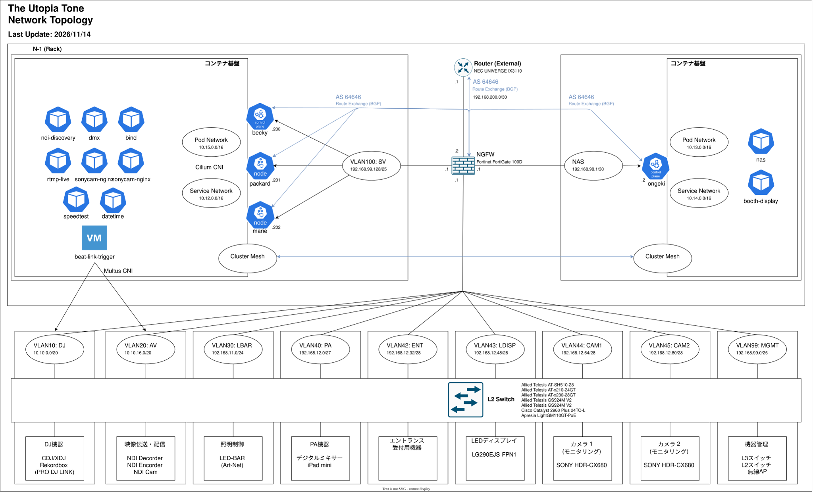
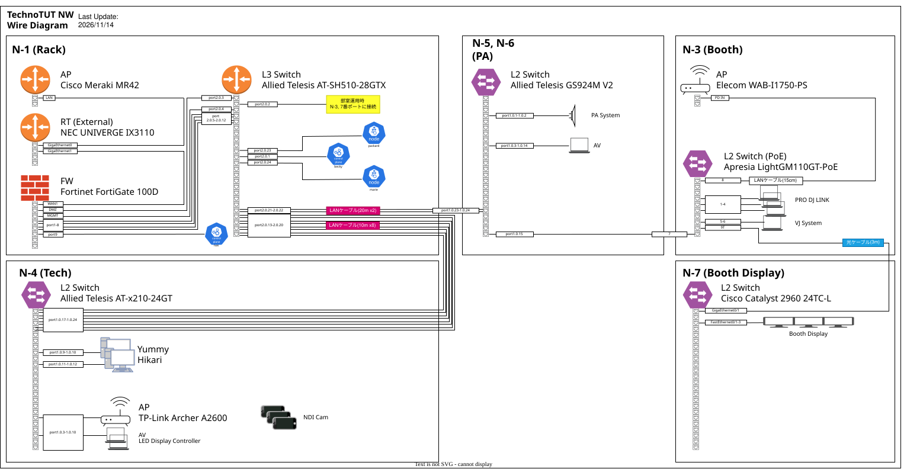

## 主要機器の役割

| 役割 | 機器 | 内容 | 設定 |
| :--- | :--- | :--- | :--- |
| 対外接続ルータ (N-1-RT) | NEC UNIVERGE IX3110 | 対外接続回線の終端と NAPT。外部拠点との IPsec VPN。FortiGate・外部拠点と BGP で経路を交換する | [IX3110.txt](https://github.com/TechnoTUT/Infra/blob/main/network/config/IX3110.txt) |
| NGFW (TTUT-FG) | Fortinet FortiGate 100D | 全 VLAN のゲートウェイ、DHCP・DNS サーバ、VLAN 間とインターネットへの通信制御。IX3110 と Kubernetes のノードの BGP ピア | [FG100D.txt](https://github.com/TechnoTUT/Infra/blob/main/network/config/FG100D.txt) |
| コアスイッチ (N-1, ラック) | Allied Telesis AT-SH510-28GTX | L2 の中心。VLAN 10・20 の IGMP Snooping Querier | [AT-SH510-28GTX.txt](https://github.com/TechnoTUT/Infra/blob/main/network/config/AT-SH510-28GTX.txt) |
| PA 用スイッチ (N-4, PA 卓) | Allied Telesis AT-x210-24GT | PA 機器と AV 機器の収容 | [AT-x210-24GT.txt](https://github.com/TechnoTUT/Infra/blob/main/network/config/AT-x210-24GT.txt) |
| エリアスイッチ (N-5, N-6) | Allied Telesis GS924M V2 | PA 機器と AV 機器の収容 (IGMP Snooping 有効) | [N-5-GS924MV2.cfg](https://github.com/TechnoTUT/Infra/blob/main/network/config/N-5-GS924MV2.cfg), [N-6-GS924MV2.cfg](https://github.com/TechnoTUT/Infra/blob/main/network/config/N-6-GS924MV2.cfg) |
| DJ・VJ 用スイッチ (N-3) | APRESIA ApresiaLightGM110GT-PoE | PRO DJ LINK (VLAN 10) と VJ (VLAN 20) の機器の収容、AP への PoE 給電 | [APLGM110GTPoE.txt](https://github.com/TechnoTUT/Infra/blob/main/network/config/APLGM110GTPoE.txt) |

## 構成図

## 機材一覧

### L3
[NEC UNIVERGE IX3110](https://jpn.nec.com/univerge/ix/Info/ix3110.html)\
[Allied Telesis AT-SH510-28GTX](https://www.allied-telesis.co.jp/support/list/switch/x510/manual.html)

### Security
Fortinet FortiGate 100D

### L2
[Allied Telesis AT-x210-24GT](https://www.allied-telesis.co.jp/support/list/switch/x210/manual.html)\
[Allied Telesis GS924M V2 x2](https://www.allied-telesis.co.jp/support/list/switch/gs900mv2/manual.html)\
[ApresiaLightGM110GT-PoE](https://www.apresia.jp/products/apresialight/aplgm110gtpoe2.html)\
[Cisco Catalyst 2960 Plus 24TC-L](https://www.cisco.com/c/ja_jp/support/switches/catalyst-2960-plus-24tc-l-switch/model.html)

### AP
[Cisco Aironet 2700](https://www.cisco.com/c/ja_jp/support/wireless/aironet-2700-series-access-point/series.html)\
[ELECOM WAB-I1750-PS](https://www.elecom.co.jp/products/WAB-I1750-PS.html)\
[TP-Link Archer A2600](https://www.tp-link.com/jp/home-networking/wifi-router/archer-a2600/)\
[TP-Link RE305](https://www.tp-link.com/jp/home-networking/range-extender/re305/)\
[GL.iNet GL-AR300M16-EXT](https://www.gl-inet.com/products/gl-ar300m16-ext/)
