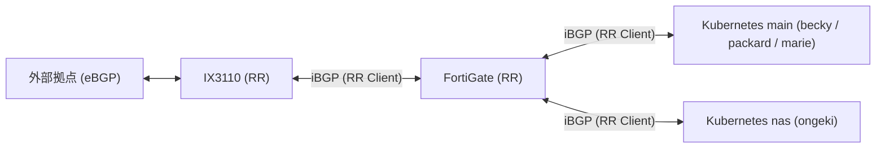

## 用語解説

このページに出てくる L3 の用語です。

### ルーティングとデフォルトルート

ルーティングは、パケットの宛先に応じて、次の転送先 (ネクストホップ) を決める仕組みです。宛先が経路表のどれにも当てはまらないときの転送先を、**デフォルトルート**と呼びます。このネットワークでは、IX3110 のデフォルトルートが上流ルータへ向いています。

### BGP

組織やネットワークの境界で、経路を交換するためのプロトコルです。ネットワークごとに **AS 番号**を持ち、AS をまたぐ BGP を **eBGP**、同じ AS の中の BGP を **iBGP** と呼びます。経路を相手に伝えることを「広報」、別の経路制御から取り込んで BGP に載せることを「再配布」と呼びます。会場内の AS 番号は `64646` です。

### Route Reflector (RR)

iBGP は、ループを防ぐために、受け取った経路を別の iBGP ピアへ再広報しません。そのため、全ての機器どうしを直接つなぐ (フルメッシュ) 必要があります。Route Reflector は、受け取った経路を他のピアへ中継する役で、フルメッシュを避けられます。中継される側を RR クライアントと呼びます。詳しくは [Route Reflector (RR) 構成](#route-reflector-rr-構成) を参照してください。

### IPsec

IP パケットを暗号化・認証して、離れた拠点の間を安全につなぐ VPN の方式です。鍵の交換には IKEv2 を使います。このネットワークでは、IX3110 が外部の 2 拠点と IPsec のトンネルを張り、その上で BGP を使って経路を交換します。

### NAPT

プライベートアドレスを、ポート番号も使って、1 つの外向きのアドレスに変換する仕組みです。このネットワークでは、IX3110 が対外接続で NAPT を行います。

## 構成

対外接続回線から順に、IX3110 (対外接続ルータ)、FortiGate 100D (NGFW) とつながります。

- 対外接続回線は上流ルータ (`192.168.8.1`) です。IX3110 が NAPT を行い、デフォルトルートを上流ルータに向けます。
- IX3110 は外部の 2 拠点と IPsec (IKEv2) VPN を張り、BGP で経路を交換します。
- L3 の処理は FortiGate に集約しています。全ての VLAN のゲートウェイは FortiGate です (詳細は [FW](/network/fw))。

## ルーティング

経路交換には BGP のみを使います。会場内の AS 番号は `64646` です。

| ピア | 種別 | セグメント | 交換する経路 |
| :--- | :--- | :--- | :--- |
| IX3110 (`192.168.200.1`) ⇔ FortiGate (`192.168.200.2`) | iBGP | `peer` (VLAN 101, `192.168.200.0/30`) | 対外接続と会場内の経路 |
| FortiGate (`192.168.99.129`) ⇔ Kubernetes のノード (`192.168.99.200` - `.202`) | iBGP | `SV` (VLAN 100, `192.168.99.128/25`) | ノードから LoadBalancer IP (`10.12.0.0/16`) と Pod CIDR (`10.15.0.0/16`) |
| IX3110 (`192.168.250.2`) ⇔ 外部拠点 ddlia-net (`192.168.250.1`, AS `65000`) | eBGP | IPsec `Tunnel0.0` (`192.168.250.0/30`) | 拠点間の経路 |
| IX3110 (`192.168.250.10`) ⇔ 外部拠点 kisarag1-net (`192.168.250.9`, AS `65500`) | eBGP | IPsec `Tunnel1.0` (`192.168.250.8/30`) | 拠点間の経路 |

- IX3110 は FortiGate を、FortiGate は Kubernetes のノードを route reflector client として扱います。Kubernetes 側の設定は [Kubernetes 構築方法](/compute/deploy) を参照してください。
- FortiGate は直結のネットワーク (各 VLAN のサブネット) を BGP に再配布します。
- IX3110 は対外接続のセグメント (`192.168.8.0/24`) を BGP で広報します。

### Route Reflector (RR) 構成

iBGP ではループ防止のため、ある iBGP ピアから受信した経路を別の iBGP ピアへは再広報しません。本来は全ノード間で iBGP のフルメッシュ接続が必要になりますが、管理を簡素化するため、AS `64646` 内では階層型の **Route Reflector (RR)** を構成しています。

- **IX3110 (RR) → FortiGate (RR Client)**: 外部拠点 (`ddlia-net`, `kisarag1-net`) との eBGP 経路や対外接続経路を FortiGate へ中継し、FortiGate から受け取った会場内・Kubernetes 経路を外部拠点へ広報します。
- **FortiGate (RR) → Kubernetes ノード (RR Client)**: `main` クラスタの各ノード (`becky`, `packard`, `marie`) および `nas` クラスタ (`ongeki`) を RR クライアントとして収容します。ノード同士で直接 iBGP ピアを張ることなく、Cilium が広報する LoadBalancer IP や Pod CIDR の経路を相互に交換し、さらに上流の IX3110 へも経路を広報します。
