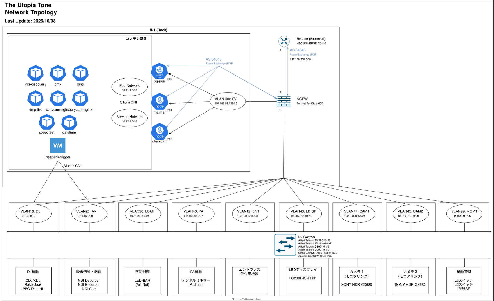
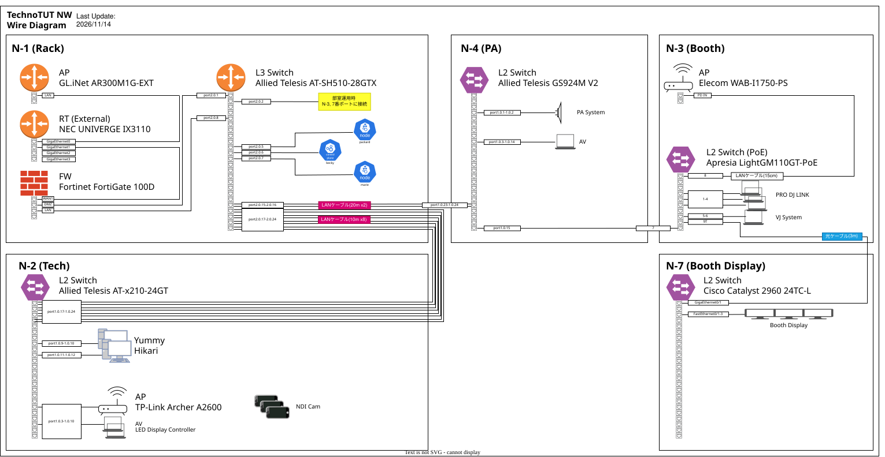

## 全体構成

対外接続回線から順に、IX3110 (対外接続ルータ)、FortiGate 100D (NGFW)、N-1 (コアスイッチ)、各エリアのスイッチとつながります。

- L3 の処理は FortiGate に集約しています。全ての VLAN のゲートウェイと DHCP サーバは FortiGate です。
- N-1 から先のスイッチは L2 として動き、全ての VLAN をトランクで運びます。
- VLAN とサブネットは [VLAN・IPアドレス設計](/network/vlan) を参照してください。

## 主要機器の役割

| 役割 | 機器 | 内容 | 設定 |
| :--- | :--- | :--- | :--- |
| 対外接続ルータ | NEC UNIVERGE IX3110 | 対外接続回線の終端。FortiGate と BGP で経路を交換する | 準備中 |
| NGFW | Fortinet FortiGate 100D | 全 VLAN のゲートウェイ、DHCP サーバ、セキュリティ制御。IX3110 と Kubernetes のノードの BGP ピア。DNS の転送先は Kubernetes 上の bind9 (`10.12.0.0`) | - |
| コアスイッチ (N-1, ラック) | Allied Telesis AT-SH510-28GTX | L2 の中心。VLAN 10・20 の IGMP Snooping Querier | [AT-SH510-28GTX.txt](https://github.com/TechnoTUT/Infra/blob/main/network/config/AT-SH510-28GTX.txt) |
| PA 用スイッチ (N-4, PA 卓) | Allied Telesis AT-x210-24GT | PA 機器と AV 機器の収容 | [AT-x210-24GT.txt](https://github.com/TechnoTUT/Infra/blob/main/network/config/AT-x210-24GT.txt) |

## ルーティング

経路交換には BGP だけを使います。AS 番号は全体で `64646` (iBGP) です。

| ピア | セグメント | 交換する経路 |
| :--- | :--- | :--- |
| IX3110 (`192.168.200.1`) ⇔ FortiGate (`192.168.200.2`) | `peer` (VLAN 101, `192.168.200.0/30`) | 対外接続と会場内の経路 |
| FortiGate (`192.168.99.129`) ⇔ Kubernetes のノード (`192.168.99.200` - `.202`) | `SV` (VLAN 100, `192.168.99.128/25`) | ノードから LoadBalancer IP (`10.12.0.0/16`) と Pod CIDR (`10.11.0.0/16`) |

FortiGate は Kubernetes のノードを route reflector client として扱います。設定は [Kubernetes 構築方法](/computing/deploy) を参照してください。

スイッチは L3 の経路を持ちません。N-1 は管理用に、デフォルトルートを FortiGate (`192.168.99.1`) に向けています。

## L2

- **VLAN**: 全てのスイッチで同じ VLAN (10, 20, 30, 40, 42-45, 99, 100) を有効にしています。トランクは全ての VLAN を通し、ネイティブ VLAN は使いません。
- **スパニングツリー**: RSTP
- **リンクアグリゲーション**:

  | スイッチ | インターフェース | ポート | 方式 | 用途 |
  | :--- | :--- | :--- | :--- | :--- |
  | N-1 | `po1` | `port2.0.5` - `2.0.12` | LACP | トランク |
  | N-1 | `po2` | `port2.0.13` - `2.0.20` | LACP | トランク |
  | N-1 | `sa1` | `port2.0.21` - `2.0.22` | 静的 | トランク |
  | N-4 | `po1` | `port1.0.17` - `1.0.24` | LACP | 上流へのトランク |
  | N-4 | `po2` | `port1.0.9` - `1.0.10` | LACP | AV (VLAN 20) の機器 |
  | N-4 | `po3` | `port1.0.11` - `1.0.12` | LACP | AV (VLAN 20) の機器 |

- **IGMP Snooping**: マルチキャストを使う DJ (VLAN 10) と AV (VLAN 20) では、N-1 が Querier になります (`10.10.0.2`, `10.10.16.2`)。
- **PoE**: 一部のスイッチは PoE で機器に給電できます。

## 管理

スイッチは MGMT (VLAN 99, `192.168.99.0/25`) で管理し、SSH (v2) で接続します。

| スイッチ | 管理 IP |
| :--- | :--- |
| N-1 | `192.168.99.2` |
| N-4 | `192.168.99.4` |

## 構成図

## 機材一覧

### L3
[NEC UNIVERGE IX3110](https://jpn.nec.com/univerge/ix/Info/ix3110.html)\
[Allied Telesis AT-SH510-28GTX](https://www.allied-telesis.co.jp/support/list/switch/x510/manual.html)

### Security
Fortinet FortiGate 100D

### L2
[Allied Telesis AT-x210-24GT](https://www.allied-telesis.co.jp/support/list/switch/x210/manual.html)\
[Allied Telesis GS924M V2 x2](https://www.allied-telesis.co.jp/support/list/switch/gs900mv2/manual.html)\
[ApresiaLightGM110GT-PoE](https://www.apresia.jp/products/apresialight/aplgm110gtpoe2.html)\
[Cisco Catalyst 2960 Plus 24TC-L](https://www.cisco.com/c/ja_jp/support/switches/catalyst-2960-plus-24tc-l-switch/model.html)

### AP
[Cisco Aironet 2700](https://www.cisco.com/c/ja_jp/support/wireless/aironet-2700-series-access-point/series.html)\
[ELECOM WAB-I1750-PS](https://www.elecom.co.jp/products/WAB-I1750-PS.html)\
[TP-Link Archer A2600](https://www.tp-link.com/jp/home-networking/wifi-router/archer-a2600/)\
[TP-Link RE305](https://www.tp-link.com/jp/home-networking/range-extender/re305/)\
[GL.iNet GL-AR300M16-EXT](https://www.gl-inet.com/products/gl-ar300m16-ext/)
