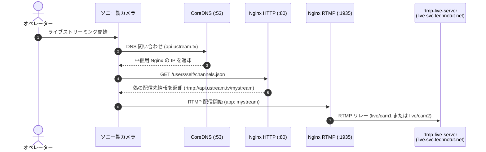

網内では、RTMP配信サーバを運用しています。\
RTMPについて: https://ja.wikipedia.org/wiki/Real_Time_Messaging_Protocol

<RepoCard repo="TechnoTUT/rtmp-live-server" />

## 統計情報の確認
統計情報を確認するには、ブラウザで http://live.svc.technotut.net/stat にアクセスしてください。

## サーバへの配信
サーバへの配信には、OBS StudioなどのRTMP配信に対応したソフトウェアが必要です。\
配信URLは `rtmp://live.svc.technotut.net/live`、ストリームキーは他と被らない一意の文字列を指定します。(使用中のストリームキーは[統計情報](http://live.svc.technotut.net/stat)で確認できます)

### ソニー製カメラからの配信
ソニー製カメラからの配信は、コンテナ基盤上で独自に構築したRTMP配信サーバを利用します。\
独自に構築したRTMP配信サーバの詳細は以下を参照してください。

<RepoCard repo="TechnoTUT/sony-camera-rtmp-relay" />

#### 仕組み
ソニー製カメラ (Sony HDR-CX680 等) のライブストリーミング機能は、もともと Ustream (`api.ustream.tv`) への配信を前提としています。そこで、カメラ側の名前解決と API 応答をコンテナ基盤上でエミュレートし、網内の `rtmp-live-server` へ中継する仕組みを採用しています。



カメラが 2 台同時に同じ仕組みで配信できるよう、`cam1` (VLAN 44, `TechnoTUT_Cam1`) と `cam2` (VLAN 45, `TechnoTUT_Cam2`) でそれぞれ独立した CoreDNS と Nginx を動かしています。

| カメラ | SSID / VLAN | CoreDNS IP | Nginx (中継) IP | 転送先 |
| :--- | :--- | :--- | :--- | :--- |
| `cam1` | `TechnoTUT_Cam1` (VLAN 44) | `10.12.77.253` | `10.12.77.252` | `rtmp://rtmp-service.live:1935/live/cam1` |
| `cam2` | `TechnoTUT_Cam2` (VLAN 45) | `10.12.77.254` | `10.12.77.251` | `rtmp://rtmp-service.live:1935/live/cam2` |

カメラの DNS サーバーは、FortiGate の DHCP が配ります (VLAN 44 は `10.12.77.253`、VLAN 45 は `10.12.77.254`)。カメラの Wi-Fi 設定で DNS を手で入れる必要はありません。FortiGate には、カメラの VLAN から CoreDNS への DNS (53) と、Nginx への HTTP・RTMP を許可するポリシーがあります (`k8s/manifest/cam1`・`cam2` の `firewallpolicy.yaml` から fortigate-operator が反映します)。\
DHCP の設定を変えても、すでに接続しているカメラは、リースを更新するまで古い DNS を持っています。変更後は、カメラの Wi-Fi を切って、つなぎ直してください。

CoreDNS が答えるか、VLAN の側から確かめるときは、[AI チャット](/service/aichat) に「VLAN 44 の側から DNS サーバー 10.12.77.253 に api.ustream.tv を引いて」と聞きます (`10.12.77.252` が返れば正常です)。

#### カメラの初期設定・配信手順
配信にあたって、カメラのWi-Fi設定でSSID `TechnoTUT_Cam1` または `TechnoTUT_Cam2` に接続し、あらかじめ [Sony-PMCA-RE](https://github.com/ma1co/Sony-PMCA-RE/releases) を使ってカメラにダミーの配信設定ファイル (`stream.cfg`) を書き込んでおく必要があります。

```powershell
curl https://raw.githubusercontent.com/TechnoTUT/sony-camera-rtmp-relay/refs/heads/main/stream.cfg -o stream.cfg
pmca-console-v0.18-win.exe stream -w stream.cfg
```

配信を行うには、カメラ本体から以下のように操作します。\
https://helpguide.sony.net/cam/1610/v1/ja/contents/TP0000949148.html
> 動画、静止画の撮影画面で、[MENU] →［ワイヤレス］→［ 機能］→［ライブストリーミング］を選ぶ。\
> START/STOPボタンを押して配信を開始する。\
配信準備中には［接続中］の表示と登録されているSSIDが表示され、配信が開始されると [LIVE] が表示されます。\
> 配信を停止するには、もう一度START/STOPボタンを押す。配信の停止が完了するまでは [LIVE] が点滅表示されます。

また、配信時の録画設定を有効にすると、配信と同時に記録メディアに動画が保存されます。遠隔で撮影映像を確認しながら同時に高画質な動画を保存できるため、有効に設定しておくことを推奨します。

### 外部機器への映像配信
外部の配信サーバに映像を配信するには、`rtmp://live.svc.technotut.net/external/<任意のストリームキー>` に配信します。

## サーバからの映像取得
サーバからの映像取得には、VLC media playerなどのRTMP再生に対応したソフトウェアが必要です。
取得URLは `rtmp://live.svc.technotut.net/live/<ストリームキー>` です。ストリームキーが不明な場合は、[統計情報](http://live.svc.technotut.net/stat)で確認できます。

### ソニー製カメラの映像取得
ソニー製カメラの映像取得には、`rtmp://live.svc.technotut.net/live/cam1` または `rtmp://live.svc.technotut.net/live/cam2` にアクセスします。
