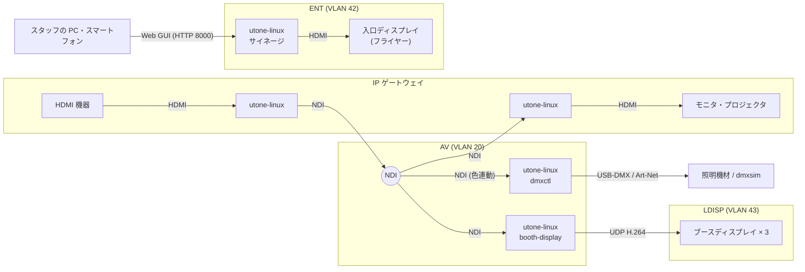
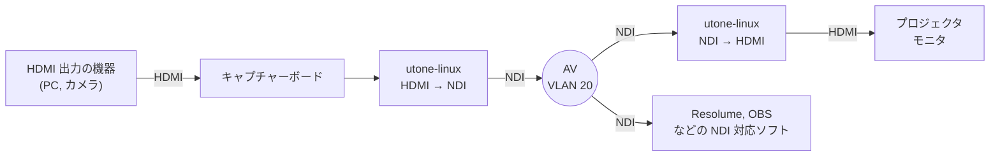
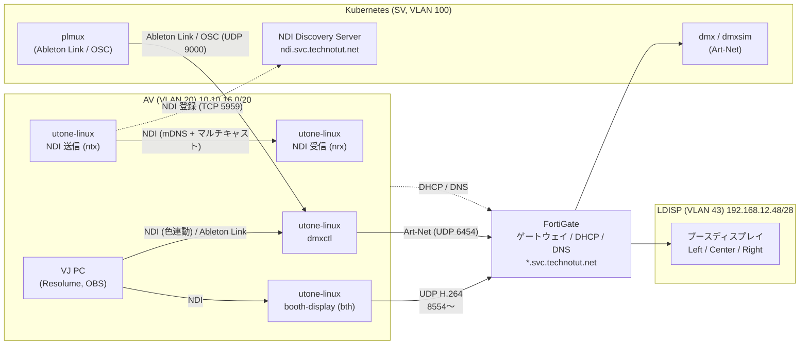
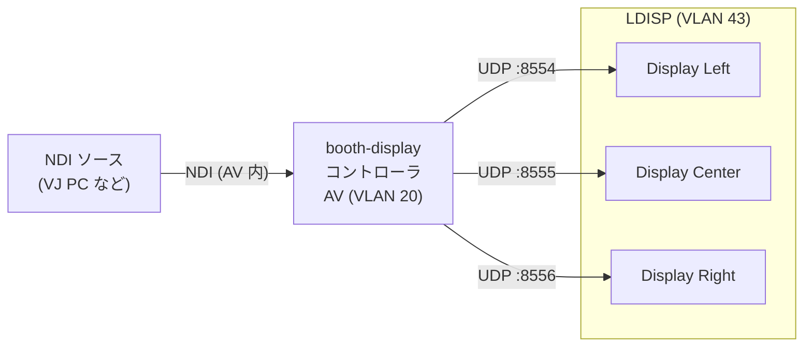

[utone-linux](https://github.com/TechnoTUT/utone-linux) は、The Utopia Tone の会場ネットワークの末端 (エッジ) に置く端末向けの Linux です。HDMI と NDI を相互に変換する IP ゲートウェイのほか、入口のフライヤー表示、NDI をブースディスプレイ用に変換する IP-IP の映像変換、照明制御ソフトウェアの実行も担います。Debian Live をもとにしており、DVD や USB メモリから起動するだけで使えます。OS のインストールは不要です。

次の 3 つのツールを同梱しています。

| ツール | 機能 | 主に使う VLAN |
| :--- | :--- | :--- |
| [moip-toolkit](https://github.com/TechnoTUT/moip-toolkit) | NDI の受信 (RX)・送信 (TX)、デジタルサイネージ、Web UI | AV (VLAN 20) |
| [booth-display](https://github.com/TechnoTUT/booth-display) | DJ ブースのタイル状ディスプレイ (LG LD290EJS-FPN1 × 3 枚) へ映像を配信するコントローラ | AV (VLAN 20) → LDISP (VLAN 43) |
| [dmxctl](https://github.com/TechnoTUT/dmxctl) | USB-DMX / Art-Net による照明制御、Ableton Link / OSC 同期 | AV (VLAN 20) |

## utone-linux の役割

utone-linux は、会場で次の 4 つの役割を担います。

| 役割 | 内容 | 使う機能 | 接続する VLAN |
| :--- | :--- | :--- | :--- |
| IP ゲートウェイ | HDMI と NDI の相互変換 | [送信 (TX)](#送信-tx)、[受信 (RX)](#受信-rx) | AV (VLAN 20) |
| 入口のフライヤー表示 | Web GUI からフライヤー画像を差し替えて表示 | [サイネージ](#サイネージ) | ENT (VLAN 42) |
| IP-IP の映像変換 | NDI をブースディスプレイ用のストリームに変換して送出 | [ブースディスプレイ](#ブースディスプレイ) | AV (VLAN 20) → LDISP (VLAN 43) |
| 照明制御 | USB-DMX や Art-Net による灯体制御・演出同期 | [照明制御 (dmxctl)](#照明制御-dmxctl) | AV (VLAN 20) |



### IP ゲートウェイ (HDMI ⇔ NDI)

HDMI などのベースバンド映像と、IP ネットワーク上の映像 (NDI) とを相互に変換します。会場の映像機器の多くは HDMI でしか入出力できませんが、utone-linux を間に置くことで、それらを AV (VLAN 20) のネットワークにつなげます。

| 変換 | 機能 | 使い方の例 |
| :--- | :--- | :--- |
| HDMI → NDI | キャプチャーボードの映像を NDI で送信 | DJ・VJ の PC やカメラの HDMI 出力をネットワークに載せる |
| NDI → HDMI | NDI ソースを受信してディスプレイにフルスクリーン表示 | ネットワーク上の映像を、HDMI 入力しかないプロジェクタやモニタに映す |



HDMI ケーブルは長くても 15〜20m 程度しか引けませんが、NDI に変換すれば LAN ケーブルとスイッチで会場のどこへでも映像を運べます。1 つの映像を複数の受信側で同時に受け取ることもできます。

### 入口のフライヤー表示

入口のディスプレイに utone-linux をつなぎ、イベントのフライヤーを表示します。画像はブラウザの Web GUI からアップロードして差し替えるため、表示用の端末を直接操作する必要はありません。当日のタイムテーブル変更などにも、手元の PC やスマートフォンからすぐ対応できます。

- 表示用の端末は、エントランス・受付用の ENT (VLAN 42) に接続します。
- DJ (VLAN 10) の DJ ブースの PC などからも Web GUI を操作できます。

### IP-IP の映像変換 (NDI → ブースディスプレイ)

ブースディスプレイは NDI を直接受信できません。utone-linux (booth-display) が AV (VLAN 20) で NDI を受信し、3 枚のディスプレイ用に映像を切り出して、ディスプレイが受信できる H.264 の UDP ストリームに変換します。変換したストリームは LDISP (VLAN 43) のディスプレイへ送出します。IP で受けた映像を IP で送り出すため、HDMI を経由しません。

VJ の映像を NDI で出すだけで、DJ ブースのディスプレイにも映せます。

## ネットワークとの関係

utone-linux の各機能は、網内の次のネットワーク・サービスを使います。



| 機能 | 接続する VLAN | 使う網内サービス・設定 | 通信 |
| :--- | :--- | :--- | :--- |
| IP アドレスの取得 | AV (VLAN 20) | FortiGate の DHCP (`10.10.20.1` 〜 `10.10.31.254`) | DHCP |
| 名前解決 | AV (VLAN 20) | FortiGate の DNS。`svc.technotut.net` のレコードは Kubernetes の ExternalDNS が FortiGate に登録する | DNS |
| NDI 送受信 | AV (VLAN 20) | mDNS による機器検出。マルチキャスト送信のため N-1 が IGMP Snooping Querier | mDNS (UDP 5353)、NDI (TCP/UDP 5959〜)、マルチキャスト `239.255.0.0/16` |
| NDI ソースの登録・検索 | AV (VLAN 20) | [NDI Discovery Server](/service/ndi#ndi-discovery-server) (設定済み)。現在は VLAN をまたいだ NDI はできない | TCP 5959 |
| フライヤー表示 (サイネージ Web GUI) | ENT (VLAN 42) | DHCP (`192.168.12.34` 〜 `192.168.12.46`)。DJ (VLAN 10) からもアクセス可能 | HTTP (TCP 8000) |
| ブースディスプレイへの配信 | AV (VLAN 20) → LDISP (VLAN 43) | AV から LDISP へストリーム送出 | UDP 8554〜 (ディスプレイごとに 1 ポート) |
| booth-display Web GUI | AV (VLAN 20) | — | HTTP (TCP 8080)、WebSocket |
| 照明制御 (`dmxctl`) | AV (VLAN 20) | NDI からの色取得、[plmux](/service/plmux) / VJ との Ableton Link・OSC 連携、Art-Net で `dmx` / `dmxsim` へ送信 | NDI、Ableton Link、OSC (UDP 9000)、Art-Net (UDP 6454) |
| リモート操作 | AV (VLAN 20) | — | SSH (TCP 22) |

VLAN とサブネットは [VLAN 一覧](/network/l2#vlan-一覧)、VLAN 間の通信制御は [FW](/network/fw) を参照してください。

<Admonition type="info">

- NDI を扱う utone-linux の端末は **AV (VLAN 20)** のポートに接続します。NDI は mDNS で機器を検出するため、送信側と受信側は同じ VLAN に置きます。入口のフライヤー表示だけに使う端末は **ENT (VLAN 42)** に接続します。
- AV からインターネットへは HTTP/HTTPS だけが通ります。Kubernetes の Service・Ingress へは HTTP, HTTPS, RTMP, RDP, VNC が通ります。
- DJ (VLAN 10) の DJ ブースや PA (VLAN 40) の PA 卓の PC からも Web UI を操作できます。

</Admonition>

## 準備

1. [Releases](https://github.com/TechnoTUT/utone-linux/releases) から ISO イメージをダウンロードします。
2. DVD に書き込むか、[Rufus](https://rufus.ie/) などで USB メモリに書き込みます。
   - 再起動後も設定を残したい場合は、Rufus で永続ストレージ (persistence) のサイズを指定します。多くの場合 1GB で足ります。
   - NDI 送信やサイネージを使う場合は、永続ストレージを設定しておくことを推奨します。
3. PC に挿して起動すると Live 環境が立ち上がります。
4. LAN ケーブルを、役割に合った VLAN のポートに接続します (NDI・ブースディスプレイは AV (VLAN 20)、フライヤー表示は ENT (VLAN 42))。ログイン時に、DHCP で取得した IP アドレスが表示されます。

ホスト名の初期値は `debian` です。NDI の送信名はホスト名から決まるため、複数台を使う場合はホスト名を変更します。

```bash
sudo hostnamectl set-hostname <新しいホスト名>
```

## NDI

utone-linux は NDI の送受信機能を標準で搭載しています。NDI そのものについては [NDI](/service/ndi) を参照してください。

### 受信 (RX)

```bash
nrx
```

ソース名を省略すると、ネットワーク上の NDI ソースを検出して対話的に選択できます。

起動時に自動で受信するには、`~/.config/systemd/user/ndi-rx.service` の `__SOURCE_NAME__` を受信したいソース名に書き換えてから、サービスを有効にします。

```bash
vim ~/.config/systemd/user/ndi-rx.service
systemctl --user enable --now ndi-rx.service
```

`ndi-rx.service` は `kmsdrm` ドライバを使い、デスクトップのコンポジタを通さずディスプレイに直接描画します (1〜2 フレーム遅延が減ります)。この場合、次の条件があります。

- そのディスプレイでデスクトップセッションが動いていないこと。`sudo systemctl set-default multi-user.target` で GUI なしで起動できます。
- ユーザが `video` と `input` グループに属していること: `sudo usermod -aG video,input $USER`
- 出力は常にフルスクリーンです。

デスクトップのコンポジタを使う場合は、`ExecStart` 行から `--video-driver kmsdrm` を削除します。

### 送信 (TX)

キャプチャーボードの映像を NDI で送信します。

```bash
ntx
```

`<ホスト名> (TX)` という名前で送信されます。送信名・解像度・フレームレートなどを変更するには、`~/.config/systemd/user/ndi-tx.service` を編集してサービスを有効にします (初期値は 1280×720, 60fps, 音声なし)。引数の一覧は `ntx --help` で確認できます。

```bash
vim ~/.config/systemd/user/ndi-tx.service
systemctl --user enable --now ndi-tx.service
```

### ネットワーク設定

NDI の設定は `~/.ndi/ndi-config.v1.json` にあり、網内向けに次の値が設定済みです。

| 項目 | 値 | 意味 |
| :--- | :--- | :--- |
| `networks.discovery` | `10.12.230.254` | NDI Discovery Server のアドレス。mDNS の代わりにソースを登録・検索する |
| `multicast.send` | 有効、`239.255.0.0/16` | マルチキャスト送信。AV では IGMP Snooping が有効 |
| `rudp.recv` / `unicast.recv` | 有効 | UDP (Reliable UDP)・ユニキャストでの受信 |
| `tcp.recv` | 無効 | TCP での受信は使わない |
| `groups` | `public` | 送受信グループ |

mDNS のために `avahi-daemon` も同梱しています。

## サイネージ

入口のフライヤー表示に使う機能です。moip-toolkit の Web GUI から画像をアップロードすると、接続したディスプレイにフルスクリーンで表示します。

```bash
systemctl --user enable --now ndi-web.service
```

ブラウザで `http://<IPアドレス>:8000/` を開きます。同じ Web UI から、NDI ソースの検出、受信 (RX) の切り替え、送信 (TX) の開始・停止もできます。API ドキュメントは `http://<IPアドレス>:8000/docs` です。再起動後も有効にしておくには永続ストレージを使います。

コマンドラインから直接表示することもできます。

```bash
/opt/moip-toolkit/.venv/bin/python /opt/moip-toolkit/main.py signage -i /path/to/image.png --fullscreen
```

`-i` を省略すると、Web UI から最後にアップロードした画像を表示します。GUI のないコンソール (TTY) では `--framebuffer` を付けると、Linux のフレームバッファに直接描画します (root 権限が必要な場合があります)。

## ブースディスプレイ

IP-IP の映像変換に使う機能です。booth-display は、3 枚のディスプレイ (各 1920×540) を 1 枚の仮想キャンバス (5760×540, 30fps) として扱い、ディスプレイごとに切り出した映像を H.264 で UDP 配信します。入力にはテストパターン、動画ファイル、NDI ソースを使えます。

```bash
bth
```

自動で起動するには、サービスを有効にします。

```bash
systemctl --user enable --now booth.service
```

ブラウザで `http://<IPアドレス>:8080/` を開くと Web GUI を使えます。プレビュー、ディスプレイの接続状態 (FPS、ビットレート、ドロップ率)、入力の切り替えを確認・操作できます。

### ネットワーク構成



- コントローラは NDI を受信するため AV (VLAN 20) に置き、ディスプレイは LDISP (VLAN 43) に置きます。
- ディスプレイの IP アドレス・ポート・切り出し位置は `/opt/booth-display/config.yaml` で設定します。初期値は全て `127.0.0.1` (ポート `8554` 〜 `8556`) なので、実際のディスプレイのアドレスに書き換えます。Web GUI の設定画面からも変更できます。
- `config.yaml` にディスプレイのアドレスを書くため、ディスプレイの IP アドレスは固定します。
- Intel GPU の VA-API (`h264_vaapi`) があればハードウェアでエンコードし、なければ `libx264` に切り替わります。
- NDI 入力には NDI SDK のランタイム (`libndi.so.6`) を使います。ISO のビルド時に `/usr/local/lib` にインストールされます。

詳細は [booth-display の README](https://github.com/TechnoTUT/booth-display) を参照してください。

## 照明制御 (dmxctl)

[dmxctl](https://github.com/TechnoTUT/dmxctl) は、デスクトップ環境なしでディスプレイに直接描画する KMS/DRM 版 (`dmxctl-kmsdrm`) として同梱されています。コンソール (TTY) または SSH から実行すると、接続されたディスプレイにフルスクリーンで UI が表示されます。

```bash
dmxctl-kmsdrm
```

起動時に自動で立ち上げる場合は、ユーザサービスを有効にします。

```bash
systemctl --user enable --now dmxctl.service
```

- 終了するときは `Ctrl+Q` またはメニューの `File → Quit` を使います（停止前にレーザー消灯・ディマー 0 の安全値を送信します）。
- 別のアプリ（例: `nrx`）がディスプレイを使用している間は起動できません。
- Live ユーザーは `video`・`input`・`dialout` グループに所属しているため、ディスプレイ・キーボード/マウス・USB-DMX (`/dev/ttyUSB0`) を追加設定なしで利用できます。
- 設定は `~/.config/dmxctl/` に保存されます。再起動後も設定を残す場合は、永続ストレージ (persistence) を設定してください。
- UI の表示倍率は `DMXCTL_SCALE=1.5 dmxctl-kmsdrm` のように環境変数で変更できます。

詳細は [dmxctl の README](https://github.com/TechnoTUT/dmxctl) を参照してください。

## コマンドとサービスの一覧

| コマンド | systemd ユーザサービス | 内容 | ポート |
| :--- | :--- | :--- | :--- |
| `nrx` | `ndi-rx.service` | NDI 受信 | — |
| `ntx` | `ndi-tx.service` | NDI 送信 | NDI (TCP/UDP 5959〜) |
| `nweb` | `ndi-web.service` | moip-toolkit の Web UI・API (サイネージ) | TCP 8000 |
| `bth` | `booth.service` | booth-display コントローラ | TCP 8080 (Web GUI)、UDP 8554〜 (送信) |
| `dmxctl-kmsdrm` | `dmxctl.service` | 照明制御 (KMS/DRM) | — (USB-DMX / Art-Net / OSC / Ableton Link) |

サービスのファイルは `~/.config/systemd/user/` にあります。

## ISO のビルド

[live-build](https://wiki.debian.org/DebianLive) でビルドします。Dev Container を使うのが簡単です (Docker か Podman が必要)。

1. VS Code でリポジトリを開き、`Dev Containers: Reopen in Container` を実行します。
2. コンテナ内で `make build` を実行します。

Debian (WSL2 でも可) で直接ビルドする場合は、`live-build` と `make` をインストールし、サブモジュールごとクローンします。

```bash
sudo apt install live-build make
git clone https://github.com/TechnoTUT/utone-linux.git --recursive
cd utone-linux
make build
```

`work/utone-linux-amd64.hybrid.iso` が生成されます。`make clean` でビルド成果物を削除します。

## トラブルシューティング

- **NDI ソースが見つからない**: 送信側と受信側が同じ VLAN (AV) にあるか確認します。マルチキャストで送信した映像が届かない場合は、IGMP Snooping の Querier (AV では N-1) が動いているか確認します。詳しくは [NDI](/service/ndi) を参照してください。
- **IP アドレスが取得できない**: 接続したポートが AV (VLAN 20) または ENT (VLAN 42) か確認します。LBAR (VLAN 30) と SV (VLAN 100) では DHCP を提供していません。
- **ブースディスプレイに映らない**: Web GUI でディスプレイの接続状態を確認し、`config.yaml` のアドレスとポートがディスプレイ側の設定と合っているか確認します。
- **`*.svc.technotut.net` が引けない**: DHCP で配られた DNS サーバ (FortiGate) を使っているか確認します。
